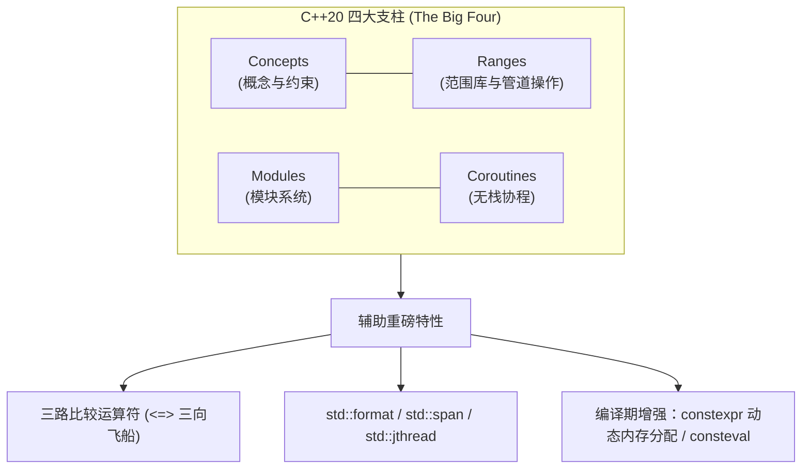
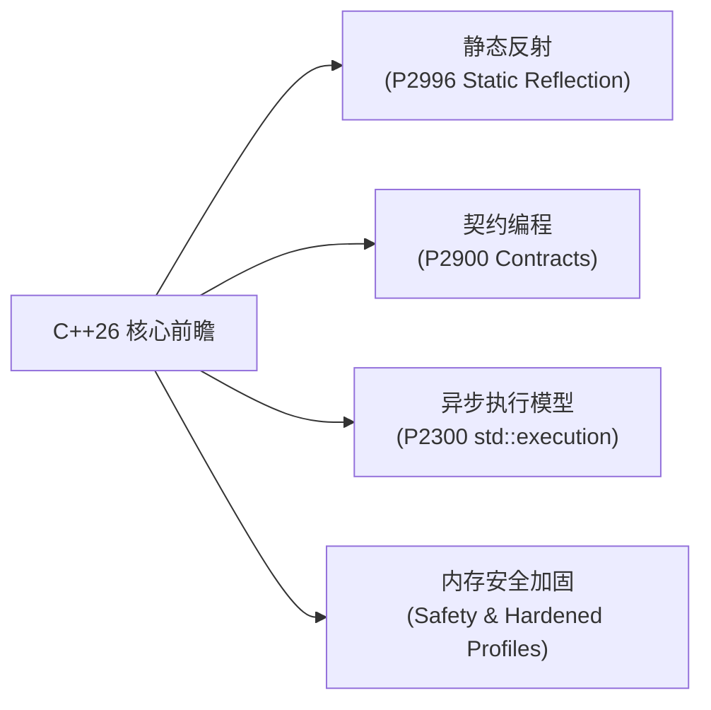

# 1.1.2 C++ 标准版本：C++98 到 C++26

掌握各标准的重要特性、发布时间脉络及版本之间的差异。

---

## 导航

← 上一节：[1.1.1 C++ 的起源与发展：从 C with Classes 到现代 C++](../01_c__的起源与发展_从_c_with_classes_到现代_c/index.md)
↑ 返回上级：[1.1 C++ 的历史、标准与设计哲学](../index.md)
下一节：[1.1.3 现代 C++ 的核心设计原则](../03_现代_c__的核心设计原则/index.md) →

---

## 标准化脉络总览：“发布火车”模型

在 1998 年发布第一个正式国际标准后，C++ 的标准化节奏曾经历过长达 13 年的停滞与探索期（C++98 到 C++11）。为了避免因个别大型特性的争论而无限期推迟整个标准的交付，ISO C++ 委员会（WG21）在 C++11 之后确立了 **“发布火车”（The Train Model）机制**：

> **每三年准时发出一班“标准列车”**。如果某项提案在截止日期前足够成熟、通过了所有投票并完成了规范文本撰写，它就可以登上这趟列车；反之，若尚未就绪，则绝不延期等待，而是留待搭乘下一班车。

这一机制彻底盘活了 C++ 的演进节奏，使现代 C++ 能够稳健、高频地吸纳工业界与学术界的最新成果。

### C++ 标准演进全景图

| 标准代号 | 正式 ISO 标准号 | 发布年份 | 定位与核心主题 | `__cplusplus` 宏常量 |
| :--- | :--- | :--- | :--- | :--- |
| **C++98** | ISO/IEC 14882:1998 | 1998 | 首个国际标准，确立面向对象与 STL | `199711L` |
| **C++03** | ISO/IEC 14882:2003 | 2003 | 技术勘误与缺陷修复，语言基本未变 | `199711L` |
| **C++11** | ISO/IEC 14882:2011 | 2011 | **划时代飞跃（现代 C++ 起点）**：移动语义、并发、类型推导 | `201103L` |
| **C++14** | ISO/IEC 14882:2014 | 2014 | 对 C++11 的查漏补缺与小幅完善 | `201402L` |
| **C++17** | ISO/IEC 14882:2017 | 2017 | 工程实用性大升级：结构化绑定、`std::filesystem`、词法与并行算法 | `201703L` |
| **C++20** | ISO/IEC 14882:2020 | 2020 | **二次划时代跃迁**：Concepts、Ranges、Coroutines、Modules | `202002L` |
| **C++23** | ISO/IEC 14882:2024 | 2023/2024 | 完善 C++20，增强表达力：`std::print`、`std::expected`、显式对象形参 | `202302L` |
| **C++26** | *(制定中)* | 预计 2026 | 下一代前瞻：静态反射、契约编程、执行模型与安全加固 | 预计 `2026XXL` |

---

## 1. 古典时代：C++98 与 C++03

### 1.1 C++98：第一个正式标准

C++98 标志着 C++ 脱离贝尔实验室的私有实现演化，成为由 ISO 规范的国际通用编程语言。它奠定了现代 C++ 沿用至今的大量底层支柱：

1. **类与面向对象体系**：
   - 虚函数、多重继承、虚基类、抽象基类（纯虚函数）。
   - 访问控制修饰符（`public`、`protected`、`private`）。
   - 运行时类型识别（RTTI：`typeid` 与 `dynamic_cast`）。
   - 四种规范显式类型转换运算符：`static_cast`、`dynamic_cast`、`const_cast`、`reinterpret_cast`（取代不可控的 C 风格强转）。
2. **标准模板库（STL）**：
   - Alexander Stepanov 开创性的 STL 正式融入标准库，包含容器（`vector`, `list`, `deque`, `map`, `set` 等）、迭代器模型、泛型算法（`std::sort`, `std::find` 等）和函数对象。
   - 分离了数据结构与操作算法，使泛型编程成为 C++ 的核心支柱之一。
3. **异常处理机制**：
   - `try`、`catch`、`throw` 关键字，提供栈展开（Stack Unwinding）与异常安全性保障。
4. **命名空间与布尔类型**：
   - `namespace`（避免大型项目全局命名冲突）以及标准命名的顶层命名空间 `std`。
   - 原生 `bool` 类型（`true` / `false`）。
5. **模板与模板元编程的意外开端**：
   - 支持函数模板与类模板。1994 年 Erwin Unruh 在委员会会议上编写了一段能够在编译期通过报错信息打印素数的模板代码，人们才惊异地发现：**C++ 的模板实例化系统是一个图灵完备的编译期纯函数式计算系统**。

### 1.2 C++03：修正与技术报告（TR1）

C++03 本质上是 C++98 的技术勘误（Technical Corrigendum 1），并未引入重大语言级新语法。其主要工作包括：
- 澄清了价值类别与值初始化（Value Initialization）的细微歧义。
- 保证了 `std::vector` 的内存元素必须是连续存储的（C++98 未明文严格约束）。

为了弥补新标准滞后带来的库功能缺失，委员会于 2005 年发布了 **TR1（Technical Report 1）**，向社区提供了一套过渡扩展库（放在命名空间 `std::tr1` 下）。TR1 中的大部分组件（如 `shared_ptr`、`tuple`、`unordered_map`、`regex` 等）直接源自 Boost 库，并最终在 C++11 中正式转正。

---

## 2. 现代 C++ 的革命：C++11

C++11 被 Bjarne Stroustrup 誉为“**感觉像是一门新语言**”。如果说 C++98 让 C++ 成为成熟的面向对象与泛型语言，那么 C++11 则带领 C++ 跨入了安全、现代与高效的新纪元。

```mermaid
mindmap
  root((C++11 核心革新))
    资源管理
      右值引用
      移动语义
      std::move / std::forward
      智能指针 std::unique_ptr
    类型推导与语法简化
      auto 与 decltype
      统一列表初始化 {}
      基于范围的 for 循环
      尾置返回类型
    函数式与元编程
      Lambda 表达式
      std::function / std::bind
      变长参数模板
      类型萃取 type_traits
    并发与内存模型
      首个语言级内存模型
      std::thread / std::mutex
      std::atomic 原子操作
      std::future / std::promise
    常量表达式与安全性
      constexpr 编译期计算
      nullptr 强类型空指针
      enum class 强类型枚举
      static_assert 编译期断言
      override 与 final
```

### 2.1 核心语言特性解析

- **移动语义与右值引用（Rvalue References, `T&&`）**：
  彻底解决了 C++98 中昂贵的深拷贝惩罚。允许通过“偷取”临时对象内部持有的堆资源来高效构造或赋值新对象，奠定了现代 C++ 零开销资源流转的基石。
- **自动类型推导（`auto` 与 `decltype`）**：
  极大简化复杂类型书写（如嵌套迭代器类型），提高泛型代码的表达能力。
- **统一列表初始化（Uniform Initialization）**：
  采用花括号 `{}` 初始化一切对象，同时防止隐式窄化转换（Narrowing Conversion）。
- **Lambda 表达式**：
  使得算法传参无需再手写笨重的仿函数结构体（Functor），为 C++ 引入内联闭包与函数式编程支持。
- **编译期常量表达式（`constexpr`）**：
  允许将满足限制的函数和变量标注为编译期求值，将大量计算从运行时提前至编译期。
- **变长参数模板（Variadic Templates）**：
  允许模板接受任意数量、任意类型的参数，催生了类型安全的 `std::tuple` 和类似 `std::make_shared` 的通用工厂函数。
- **面向对象语义强化**：
  引入 `override`（确保正确重写虚函数）和 `final`（阻止虚函数继承或类派生）。

### 2.2 标准库的关键升级

- **智能指针体系**：`std::unique_ptr`（独占所有权，取代危险的 `std::auto_ptr`）、`std::shared_ptr`（共享所有权）与 `std::weak_ptr`（弱引用打破循环引用）。
- **语言级多线程原生支持**：首次在标准中明确了**多线程内存模型（Memory Model）**，定义了数据竞争（Data Race），并提供了 `std::thread`、互斥量 `std::mutex`、条件变量、`std::atomic` 以及期物机制 `std::future`。
- **哈希容器**：正式引入基于哈希表的非排序关联容器：`std::unordered_map`、`std::unordered_set` 等。

---

## 3. 打磨与实用化：C++14 与 C++17

### 3.1 C++14：完成 C++11 的承诺

C++14 是一个小型标准，主要目的是补齐 C++11 遗留的粗糙边缘：

- **泛型 Lambda 与初始化捕获**：
  ```cpp
  // 泛型 Lambda：参数支持 auto
  auto print = [](const auto& x) { std::cout << x << '\n'; };

  // 初始化捕获：支持将 move-only 对象捕获进 Lambda
  auto ptr = std::make_unique<int>(42);
  auto task = [p = std::move(ptr)]() { /* 使用 p */ };
  ```
- **放宽 `constexpr` 限制**：
  C++11 的 `constexpr` 函数几乎只能包含单条 `return` 语句；C++14 允许在其中使用局部变量、条件分支、循环结构及修改局部状态。
- **函数返回类型推导**：普通函数可以直接使用 `auto` 推导返回值。
- **变量模板（Variable Templates）**：例如定义类型通用的数学常量 `template<typename T> constexpr T pi = T(3.1415926535...);`。
- **标准库补全**：引入 `std::make_unique`（填补了 C++11 仅有 `std::make_shared` 的缺憾）、读写锁 `std::shared_timed_mutex` 以及字面量操作符（如时间字面量 `10s`, `250ms`）。

### 3.2 C++17：工程实用性的全面跃升

C++17 是一次幅度较大的升级，极大提升了日常业务代码的书写舒适度与安全性：

```cpp
// 1. 结构化绑定 (Structured Bindings)
std::map<std::string, int> scores{{"Alice", 95}};
for (const auto& [name, score] : scores) {
    std::cout << name << ": " << score << '\n';
}

// 2. 带初始化的 if 语句
if (auto it = scores.find("Alice"); it != scores.end()) {
    std::cout << "Found: " << it->second << '\n';
}

// 3. 编译期 if (if constexpr)：颠覆繁琐的模板偏特化与 SFINAE
template <typename T>
void process(T val) {
    if constexpr (std::is_pointer_v<T>) {
        if (val) std::cout << *val << '\n';
    } else {
        std::cout << val << '\n';
    }
}
```

- **语言特性突破**：
  - **结构化绑定（Structured Bindings）**：原生解包 `tuple`、`pair`、数组或聚合结构体。
  - **`if constexpr`**：根据编译期条件直接丢弃不匹配的分支代码，极度简化模板元编程。
  - **折叠表达式（Fold Expressions）**：一句话展开变长参数包（如 `(args + ...)`）。
  - **类模板实参推导（CTAD）**：可以直接写 `std::pair p(1, 2.0);`，无需写 `std::pair<int, double>` 或调用 `std::make_pair`。
- **标准库三大通用“轻量包装”**：
  - `std::optional<T>`：表示可能有值或无值，淘汰哨兵值与野指针错误。
  - `std::variant<Ts...>`：类型安全的联合体（Sum Type / 标签联合）。
  - `std::any`：可容纳任意可拷贝类型的类型安全容器。
- **零拷贝与系统抽象**：
  - `std::string_view`：字符串切片的非拥有只读视口，大幅消除不必要的临时 `std::string` 分配。
  - `std::filesystem`：标准跨平台文件路径、目录遍历及文件属性操作库。
  - **并行 STL（Parallel Algorithms）**：标准算法支持传入并行执行策略（如 `std::execution::par`）。

---

## 4. 划时代的二次飞跃：C++20

如果说 C++11 是对 C++98 的一次重塑，那么 **C++20 就是 C++ 诞生以来的最大一次质的飞跃**。它引入了四个具有颠覆性的核心支柱特性（“The Big Four”），从根本上改变了 C++ 代码的组织与编写范式。



### 4.1 四大支柱（The Big Four）

#### 1. 概念与约束（Concepts & Constraints）
长期以来，C++ 模板的报错信息以“冗长晦涩、深不见底”著称。Concepts 允许开发者直接在语法层面对模板类型参数施加语义约束：
```cpp
// 约束类型 T 必须支持可排序比较
template <std::totally_ordered T>
T clamp(T val, T low, T high) {
    return val < low ? low : (high < val ? high : val);
}

// 简写形式（受限 auto）
void print_hashable(const std::equality_comparable auto& item) {
    // 只有满足相等比较约束的类型才能通过编译
}
```
它终结了冗长难懂的 SFINAE 与 `std::enable_if`，使模板错误在调用处以极其清晰的人类可读信息报错。

#### 2. 范围库（Ranges）
Ranges 将算法与数据容器通过管道操作符（`|`）串联起来，引入了惰性求值视图（Views）：
```cpp
#include <vector>
#include <ranges>
#include <iostream>

std::vector<int> numbers = {1, 2, 3, 4, 5, 6};
// 筛选偶数并计算平方，全程惰性计算、无多余内存分配
auto results = numbers 
             | std::views::filter([](int n) { return n % 2 == 0; })
             | std::views::transform([](int n) { return n * n; });

for (int n : results) {
    std::cout << n << ' '; // 输出: 4 16 36
}
```

#### 3. 模块（Modules）
彻底颠覆自 C 语言继承了近 50 年的 `#include` 文本拷贝机制。
- **物理编译隔离**：模块仅导出 `export` 的公共符号，宏定义不再随头文件外溢污染。
- **编译速度质变**：模块接口文件（BMI）预先编译为二进制语义树，大型工程的编译吞吐量可提升数倍乃至数十倍。

#### 4. 协程（Coroutines）
引入了语言底层的**无栈协程（Stackless Coroutines）**基础设施，提供关键字：
- `co_await`：挂起当前协程执行，等待异步操作完成。
- `co_yield`：挂起协程并向调用方产出中间结果（生成器模式）。
- `co_return`：完成协程并返回最终结果。
协程将异步并发代码的书写体验改造成类似同步代码的顺序逻辑。

### 4.2 其他不可忽视的重磅增强

- **三路比较运算符（Spaceship Operator `<=>`）**：
  只需一个 `= default` 的 `<=>` 声明，编译器即可自动合成全部六种关系运算符（`==`, `!=`, `<`, `<=`, `>`, `>=`），免除手动繁琐且易出错的重载。
- **更强的编译期能力**：
  - `consteval`（即时函数）：强制必须在编译期执行。
  - `constinit`：强制变量必须在静态初始化阶段完成初始化，防止静态初始化顺序惨剧。
  - 允许在 `constexpr` 上下文中使用动态内存分配（`std::vector` 与 `std::string` 均可在编译期直接运行与销毁）。
- **标准库现代化拼图**：
  - `std::format`：类似 Python 格式化字符串的高性能、类型安全且易用的格式化库（性能超越 `sprintf`，易用度远胜 `std::stringstream`）。
  - `std::span`：对任何连续内存（原始数组、`std::vector`、`std::array`）的轻量级非拥有视口。
  - `std::jthread`：具备 RAII 自动析构汇合（自动 join）与协作式取消令牌（stop token）的安全线程类。

---

## 5. 臻于成熟：C++23

C++23 遵循准时交付原则，一方面修复与完善了 C++20 中未完全成型的标准库支持，另一方面引入了多项极其改善开发体验的重要新特性。

### 5.1 显式对象形参（Deducing `this`）

长期以来，若要为一个类的成员函数分别支持 `&`、`const &`、`&&` 与 `const &&` 四种修饰版本，开发者不得不编写四次几乎一模一样的代码。C++23 允许将当前对象作为显式形参传递：
```cpp
struct Value {
    // 自动推导当前对象 Self 的值类别与 const 限定
    template <typename Self>
    auto&& get_data(this Self&& self) {
        return std::forward<Self>(self).data;
    }
};
```
该特性不仅彻底消除了成员函数常/非常重载的冗余，更极大简化了经典的 **CRTP（奇异递归模板模式）**，无需再显式向下转换 `static_cast<Derived*>(this)`。

### 5.2 核心库特性全面进化

1. **`std::print` 与 `std::println`**：
   ```cpp
   std::println("Hello, {}! The value is {:.2f}", "Modern C++", 3.14159);
   ```
   直接输出到终端控制台，类型安全、无全局锁开销、不会隐式刷新缓冲区，并完美支持 Unicode 跨平台处理。正式标志着 `std::cout` 与 `printf` 在现代项目中的退役。
2. **`std::expected<T, E>`**：
   引入函数式错误处理（Monadic Operations：`and_then`、`or_else`、`transform` 等）。对于性能敏感或关闭异常的系统，函数可以优雅地返回“要么是值 `T`，要么是错误码 `E`”，取代危险的出参指针或魔数返回。
3. **`std::mdspan`**：
   多维连续/跨步内存非拥有视图，支持灵活的内存布局映射（如行优先、列优先、切片），为科学计算、高性能图形学与矩阵算法提供了通用标准接口。
4. **`std::generator`**：
   C++20 提供了协程的语言底座，但未内置生成器类型；C++23 正式引入 `std::generator<T>`，让编写惰性序列生成器如同写 Python `yield` 一样轻松：
   ```cpp
   #include <generator>

   std::generator<int> fibonacci() {
       int a = 0, b = 1;
       while (true) {
           co_yield a;
           auto next = a + b;
           a = b;
           b = next;
       }
   }
   ```
5. **Ranges 丰富化**：补齐了关键视图适配器，如 `std::views::zip`、`std::views::chunk`、`std::views::slide` 与 `std::views::cartesian_product` 等。
6. **紧凑关联容器**：引入 `std::flat_map` 与 `std::flat_set`，其底层基于连续的 `vector` 存储并通过二分查找访问，具备极高的 CPU 缓存局部性（Cache Locality）。

---

## 6. 面向未来：C++26 路线展望

C++26 目前正在由 WG21 委员会紧锣密鼓地制定中。根据目前已通过投票并被采纳的提案，以及重点攻关的核心方向，C++26 将在元编程、程序安全性和系统执行架构上迎来下一场结构性变革。



### 6.1 静态反射与代码生成（Static Reflection, P2996）

这是 C++ 社区期待超过十年的终极特性。传统的 C++ 缺乏内省机制，导致序列化（JSON/Protobuf）、对象关系映射（ORM）、RPC 调用等场景不得不依赖庞大的代码生成器或宏黑魔法。

C++26 的反射提案基于编译期操作符（如 `^^` 运算符取得反射信息 `std::meta::info`）：
```cpp
// 概念代码示意（基于 P2996 提案草案）：
struct Person {
    std::string name;
    int age;
};

// 编译期获取类型的全部非静态数据成员并自动序列化
template <typename T>
void print_fields(const T& obj) {
    constexpr auto members = nonstatic_data_members_of(^^T);
    template for (constexpr auto m : members) {
        std::println("{}: {}", name_of(m), obj.[:m:]);
    }
}
```
静态反射将以真正的零运行时开销，赋予 C++ 甚至超越动态语言的元编程表现力。

### 6.2 契约编程（Contracts, P2900）

契约编程定义了函数调用时的前置条件（Preconditions）、后置条件（Postconditions）与断言。它不仅帮助静态代码分析工具发现越界与逻辑缺陷，也为编译器优化提供了权威的前置假设：
```cpp
// 概念代码示意（基于 C++26 契约语法路线）：
int divide(int a, int b) 
  pre (b != 0)          // 前置条件：除数不得为零
  post (r: r * b <= a)   // 后置条件
{
    return a / b;
}
```

### 6.3 统一异步执行模型（`std::execution` / Senders-Receivers, P2300）

针对异构计算（CPU、GPU、协程、I/O 事件循环）缺乏统一调度抽象的问题，P2300 提出了一套标准的 Sender/Receiver 架构。它将成为后续网络库（Networking）、异构并行运算的共同底层基石。

### 6.4 内存安全与现代语言防护（Memory Safety）

在 Rust 等新兴系统语言的冲击下，内存安全性已成为整个工业界关注的焦点。C++26 正在积极推行标准化的**安全配置（Profiles）**、编译期边界检查机制、未初始化变量行为消除以及标准库硬化模式（Hardened Modes），从标准层面逐步消除未定义行为（UB）的高发温床。

---

## 7. 工业实践：版本选型与演进建议

面对层出不穷的标准版本，企业工程项目应如何做出理性选择？

```mermaid
quadrantChart
    title 现代 C++ 版本选型考量
    x-axis 迁移升级成本: 低 --> 高
    y-axis 表达力与收益: 低 --> 高
    quadrant-1 战略投资 (新架构/高性能服务): C++20 / C++23
    quadrant-2 前瞻预研 (探索下一代): C++26
    quadrant-3 遗留维护 (旧系统/特殊平台): C++98 / C++03
    quadrant-4 稳妥基石 (主流生产环境): C++14 / C++17
    "C++98/03": [0.15, 0.2]
    "C++11": [0.45, 0.55]
    "C++17": [0.55, 0.72]
    "C++20": [0.82, 0.88]
    "C++23": [0.88, 0.93]
    "C++26": [0.95, 0.98]
```

### 7.1 各行业版本采用现状

1. **金融高频量化（HFT）与尖端科技**：
   - 普遍处于 **C++20 / C++23** 的前沿梯队。极度渴求 `std::span`、Ranges、编译期运算、`std::expected` 及 Concepts 带来的类型安全与极致性能。
2. **大型游戏引擎（如 Unreal Engine 5 等）**：
   - 正在从 **C++17 全面迁移至 C++20**。注重编译速度、结构化绑定以及三向比较运算符，但对协程与模块的采用保持审慎（等待编译器与构建系统工具链完全成熟）。
3. **基础架构与云原生服务（如 Google, Meta, 数据库内核）**：
   - 绝大多数新项目基线已确立为 **C++17 或 C++20**。
4. **汽车、航空与高安全关键嵌入式**：
   - 遵守 AUTOSAR 或 MISRA 规范，通常停留在 **C++14 或审慎采用 C++17**，对语言特性有严格的白名单审查机制。

### 7.2 现代工程升级路线建议

- **基线推荐**：任何全新的 C++ 工程都不应再采用低于 **C++17** 的标准。C++17 在各大编译器（GCC、Clang、MSVC）以及主流操作系统（Linux、macOS、Windows）中均拥有极其稳定的工具链支持。
- **推荐进阶**：若团队编译器支持 GCC 11+ / Clang 13+ / MSVC 2019+，强烈建议开启 **C++20**（优先使用 Concepts、Ranges、三向比较与 `std::format`，待构建系统成熟后逐步引入 Modules）。
- **渐进淘汰**：
  - 彻底停用 C 风格类型转换、`NULL`、原始指针管理堆内存（裸 `new`/`delete`）以及宏常量。
  - 使用 `std::unique_ptr` / `std::shared_ptr` 管理资源所有权。
  - 使用 `std::string_view` 和 `std::span` 代替传统的 `const char*` 与 `(T* ptr, size_t len)` 指针传参。

---

## 总结

C++ 的标准版本演化并非杂乱无章的特性堆叠，而是围绕着一条核心主线持续推进：**在永不妥协“底层零开销控制力”的前提下，不断吸纳现代化高阶抽象，提高代码的安全性、可读性与编译期计算能力。**

- **C++98/03**：立规之作，确立了以面向对象和泛型 STL 为核心的基础格局。
- **C++11/14**：革命之作，以移动语义和内存模型为引擎，诞生了“现代 C++”。
- **C++17**：工匠之作，扫清日常语法障碍，大幅提升日常代码的优雅度与开发效率。
- **C++20/23**：蜕变之作，Concepts、Ranges、Modules、Coroutines 与 `std::print` 将 C++ 的表达力推升至现代工业级语言的顶峰。
- **C++26 及未来**：向着静态反射、安全化与契约驱动的下一代系统级语言迈进。

在下一节中，我们将深入探究贯穿所有这些版本背后的灵魂——**现代 C++ 的核心设计原则**。

---

## 导航

← 上一节：[1.1.1 C++ 的起源与发展：从 C with Classes 到现代 C++](../01_c__的起源与发展_从_c_with_classes_到现代_c/index.md)
↑ 返回上级：[1.1 C++ 的历史、标准与设计哲学](../index.md)
下一节：[1.1.3 现代 C++ 的核心设计原则](../03_现代_c__的核心设计原则/index.md) →

