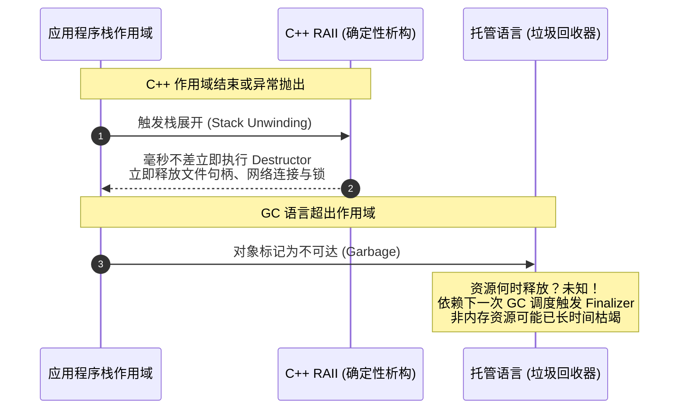

# 1.1.3.2 RAII 与确定性生命周期（Resource Acquisition Is Initialization）

将系统资源生命周期与对象作用域严格绑定，利用栈展开实现毫秒不差的确定性资源回收与强异常安全。

---

## 导航

← 上一节：[1.1.3.1 零开销抽象原则](../01_零开销抽象原则/index.md)
↑ 返回上级：[1.1.3 现代 C++ 的核心设计原则](../index.md)
下一节：[1.1.3.3 静态类型强约束与类型安全](../03_静态类型强约束与类型安全/index.md) →

---

## 1. 广义系统资源的范畴

**RAII（资源获取即初始化）**是 C++ 最伟大也最具影响力的核心设计模式。其本质可精确概括为：**将资源的生命周期严格绑定到对象的生命周期，利用栈展开与局部作用域确定性触发析构**。

许多初学者容易狭隘地将 RAII 等同于“内存管理”。实际上，现代工业软件中最容易造成严重生产事故的往往是**非内存资源**：
- 互斥锁（Mutex lock）忘记释放造成死锁；
- 文件描述符 / 套接字（Socket）泄漏耗尽系统句柄限制；
- 数据库连接、GPU 显存句柄、绘图设备上下文（Device Context）；
- 跨线程任务事务未提交或未回滚。

---

## 2. 代码对比：手动管理 vs RAII

```cpp
#include <mutex>
#include <fstream>
#include <stdexcept>

std::mutex g_mutex;

// 危险的反模式：手动管理资源
void write_log_legacy(const std::string& msg) {
    g_mutex.lock();
    FILE* fp = fopen("app.log", "a");
    if (!fp) {
        g_mutex.unlock(); // 必须在每个失败分支手动补救
        throw std::runtime_error("Open file failed");
    }
    
    if (msg.empty()) {
        fclose(fp);       // 极易遗漏的释放
        g_mutex.unlock(); // 极易遗漏的解锁
        return;
    }
    
    // 如果下面抛出异常，锁和文件描述符彻底永久泄漏！
    fputs(msg.c_str(), fp);
    
    fclose(fp);
    g_mutex.unlock();
}

// 现代 C++ 规范：纯粹的 RAII 架构
void write_log_modern(const std::string& msg) {
    // 构造即加锁，离开任何分支或抛出异常时自动解锁
    std::scoped_lock lock(g_mutex); 
    
    // 构造即打开文件，析构时自动 flush 并关闭句柄
    std::ofstream out("app.log", std::ios::app);
    if (!out.is_open()) {
        throw std::runtime_error("Open file failed");
    }
    
    if (msg.empty()) return; // 提前返回，所有资源由析构函数自动安全收尾
    
    out << msg;
}
```

---

## 3. 确定性析构 vs 垃圾回收（GC）

垃圾回收（Garbage Collection）在应用级开发中带来了便利，但在系统级、高并发与实时场景下存在内在缺陷：



1. **时效性与确定性**：RAII 保证在离开作用域的指令执行瞬间（微秒级），析构函数立刻执行；而 GC 的回收时机是不确定的，无法及时释放互斥锁与文件句柄。
2. **零停顿（No Stop-The-World）**：C++ 对象生命周期随栈的增长与回缩平滑释放，绝无任何运行期扫描整个堆内存导致的暂停与延迟抖动。

---

## 4. 异常安全的三大保证（Exception Safety Guarantees）

RAII 是实现异常安全性的基石。现代 C++ 区分三个级别的异常安全保证：
- **基本保证（Basic Guarantee）**：若发生异常，程序无资源泄漏，所有对象保持有效但可能被更改的状态。
- **强保证（Strong Guarantee）**：操作具有事务性——要么完全成功，要么发生异常并回滚到操作前的原状态。
- **不抛异常保证（Nothrow Guarantee, `noexcept`）**：操作绝不向外抛出异常（移动构造、析构函数通常必须满足此保证）。
