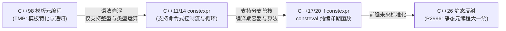

# 1.1.3.4 计算前置与编译期求值（Compile-Time Programming）

凡能在编译期求出结果的数据或逻辑，绝不拖到运行期消耗时钟周期。

---

## 导航

← 上一节：[1.1.3.3 静态类型强约束与类型安全](../03_静态类型强约束与类型安全/index.md)
↑ 返回上级：[1.1.3 现代 C++ 的核心设计原则](../index.md)
下一节：[1.1.3.5 值语义优先与移动语义流转](../05_值语义优先与移动语义流转/index.md) →

---

## 1. 计算时机的前移演进

在计算机体系结构中，最快的运行期计算是**不计算**。现代 C++ 确立了极度激进的计算前置准则：**任何可以在编译期求出结果的数据或类型变换，坚决不留到运行期消耗时钟周期**。



---

## 2. `constexpr` 与 `consteval` 的实战威力

现代 C++ 允许直接使用日常的 C++ 语法（`for` 循环、局部变量、动态数组等）直接编写在编译阶段执行的函数：

```cpp
#include <array>
#include <string_view>
#include <cstdint>

// 纯编译期执行函数（C++20 consteval）
// 编译器保证此函数如果无法在编译期折叠为一个常量，直接编译报错！
consteval uint64_t compile_time_hash(std::string_view str) {
    uint64_t hash = 14695981039346656037ULL; // FNV-1a 算法
    for (char c : str) {
        hash = (hash ^ static_cast<uint64_t>(c)) * 1099511628211ULL;
    }
    return hash;
}

// 编译期生成预置哈希查找表，运行期 0 开销
void handle_event(std::string_view event_name) {
    // 运行期匹配变成了极速的 64 位整数比较，彻底消除字符串匹配开销
    switch (compile_time_hash("ON_CONNECT")) {
        // switch case 要求必须是编译期常量表达式
        case compile_time_hash("ON_CONNECT"):
            // 处理连接
            break;
        case compile_time_hash("ON_DISCONNECT"):
            // 处理断开
            break;
    }
}
```

---

## 3. 消灭静态初始化顺序陷阱（SIOF）

在 C++ 中，跨编译单元的全局/静态变量初始化顺序是未定义的（Static Initialization Order Fiasco）。通过将这些数据标注为 `constexpr` 或 `constinit`，编译器将其直接固化在二进制的可读数据段（`.rodata`），完全杜绝了运行期动态初始化的竞态风险。

---

## 4. 展望 C++26：静态反射（P2996）

传统的 C++ 在运行期缺乏反射能力，迫使大型工程不得不借助外部代码生成工具（如 Qt moc）、复杂宏替换或庞大的运行期元数据表。
C++26 正在标准化的**静态反射（Static Reflection）**将彻底改变这一现状：在编译期直接遍历结构体字段、内省函数签名并生成序列化代码，将反射的开销永远留在编译阶段。
