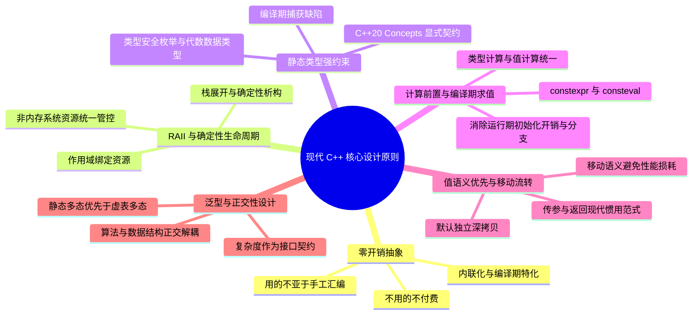

# 1.1.3 现代 C++ 的核心设计原则

理解 zero-overhead abstraction、RAII、类型安全和泛型编程等理念。

## 本节目录

- [1.1.3.1 零开销抽象原则](01_零开销抽象原则/index.md)
- [1.1.3.2 RAII 与确定性生命周期](02_raii_与确定性生命周期/index.md)
- [1.1.3.3 静态类型强约束与类型安全](03_静态类型强约束与类型安全/index.md)
- [1.1.3.4 计算前置与编译期求值](04_计算前置与编译期求值/index.md)
- [1.1.3.5 值语义优先与移动语义流转](05_值语义优先与移动语义流转/index.md)
- [1.1.3.6 泛型与正交性设计](06_泛型与正交性设计/index.md)

---

## 导航

← 上一节：[1.1.2 C++ 标准版本：C++98 到 C++26](../02_c__标准版本_c_98_到_c_26/index.md)
↑ 返回上级：[1.1 C++ 的历史、标准与设计哲学](../index.md)
下一节：[1.1.3.1 零开销抽象原则](01_零开销抽象原则/index.md) →

---

## 核心设计哲学总览

很多程序员对 C++ 的初印象往往停留在“带着面向对象特性的 C 语言”（C with Classes），或者充斥着裸指针、手动内存管理、宏替换与复杂继承体系的古老语言。然而，**现代 C++（C++11 及后续标准）在设计哲学上经历了一场脱胎换骨的范式革命**。

现代 C++ 之父 Bjarne Stroustrup 与 C++ 委员会核心成员 Herb Sutter 在制定现代规范时，提出了两条纲领性原则：

> 1. **在代码中直接表达设计意图（Express ideas directly in code）**：代码应当自解释。类型的意图、资源的所有权、算法的约束应尽可能成为类型系统的一部分，由编译器进行静态保证，而非隐藏在隐晦的指针操作或注释中。
> 2. **让接口容易用对，极难用错（Make interfaces easy to use correctly and hard to use incorrectly）**：通过强类型约束、明确的所有权转移与生命周期机制，将运行期可能出现的未定义行为（Undefined Behavior, UB）与资源泄漏在编译期直接扼杀。

现代 C++ 并非盲目堆砌语法糖，其演进始终紧密围绕着**六大核心基石原则**展开：

### 现代 C++ 与古典 C++（C++98）设计思维对照

| 维度 | 古典 C++（C++98 / C++03） | 现代 C++（C++11 ~ C++26） | 核心原则驱动 |
| :--- | :--- | :--- | :--- |
| **内存与资源管理** | 手动 `new` / `delete`，成对释放容易遗漏 | 智能指针（`unique_ptr`）、容器、RAII 卫权对象，零 `delete` | **RAII / 独占所有权** |
| **临时对象传递** | 昂贵的深拷贝，或者退化为非 `const` 指针/引用出参 | 移动语义（Move Semantics）与完美转发（Perfect Forwarding） | **值语义 + 移动语义** |
| **多态实现机制** | 大量依赖虚函数基类（Dynamic Polymorphism） | 模板、CRTP、Concepts 约束的静态多态（Static Polymorphism） | **零开销抽象 / 泛型** |
| **类型安全性** | `void*`、宏常量、非类型安全 `enum`、`0` / `NULL` | `std::any` / `variant`、`constexpr`、`enum class`、`nullptr` | **静态强类型** |
| **计算时机** | 大量查表与初始化工作留到运行期（容易出现 SIOF） | `constexpr`、`consteval`，编译期完成解析与常量折叠 | **计算前置** |
| **模板报错与约束** | 隐式鸭子类型，报错信息动辄数百行深度嵌套栈 | C++20 Concepts，违背契约时精确定位到声明与调用点 | **静态契约** |

请点击上方 **本节目录** 中的各个四级小节深入探究现代 C++ 的每一项核心设计原则。
