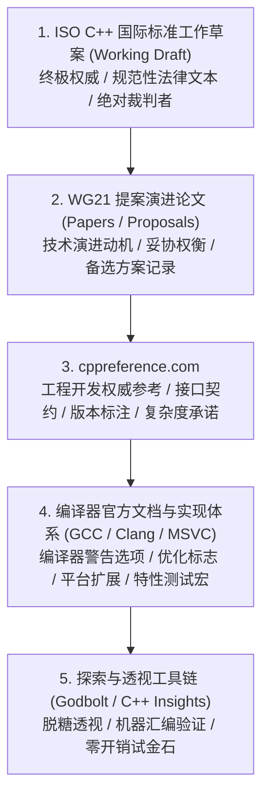
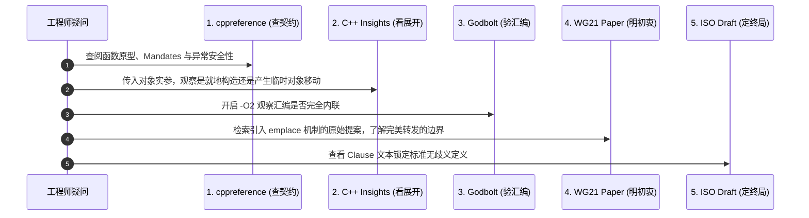

# 1.1.4 如何阅读标准、提案与编译器文档

认识 ISO C++ 标准、WG21 papers、cppreference 与编译器文档的用途。

---

## 导航

← 上一节：[1.1.3.6 泛型与正交性设计](../03_现代_c__的核心设计原则/06_泛型与正交性设计/index.md)
↑ 返回上级：[1.1 C++ 的历史、标准与设计哲学](../index.md)
下一节：[1.2 编译、链接与程序构建模型](../../02_编译_链接与程序构建模型/index.md) →

---

## 1. 为什么现代 C++ 必须重视一手文献？

在软件开发领域，C++ 可能是对“一手文献检索能力”要求最高的编程语言之一。许多开发者在学习过程中常陷入以下困境：
- **二手资料的时效性滞后**：网络上的技术博客常年混杂着 C++98、C++11 与现代标准的过时做法（例如将 C++98 中因为缺少移动语义而推荐的“传引用出参”误传为现代通用准则）；
- **对实现（Implementation）与规范（Specification）的混淆**：“在我的 GCC 上跑通了”并不等于“代码符合标准”。依赖特定编译器的非标准扩展或偶然的未定义行为（Undefined Behavior），极易在换用 Clang/MSVC 或升级编译器版本时引发灾难性生产故障；
- **误把未定义行为当成技术巧技**：不了解标准规范对边界条件的严格界定，写出看似运行正常实则随时可能被编译器优化彻底抹杀的幽灵代码。

要成长为真正能驾驭复杂系统工程的现代 C++ 架构师，必须建立清晰的**一手信息源金字塔**：



---

## 2. ISO C++ 国际标准与工作草案（Working Draft）解析

### 2.1 组织机制与免费 Working Draft

正式的 C++ 国际标准由国际标准化组织 **ISO/IEC JTC1/SC22/WG21**（简称 WG21）制定。每三年正式发布的 ISO 文本（如 ISO/IEC 14882:2020）由 ISO 官方销售且价格昂贵。

然而在工业界和开源社区中，绝大多数顶级工程师与编译器开发者日常查阅的都是**完全免费公开的工作草案（Working Draft）**：
- **在线即时交互版（首选推荐）**：[**eel.is/c++draft**](https://eel.is/c++draft/)（提供了极佳的超链接跳转、条款锚点与全局检索功能）；
- **官方 GitHub 仓库**：[cplusplus/draft](https://github.com/cplusplus/draft)（可拉取 LaTeX 源码并本地编译最新 PDF）；
- **标准快照编号**：例如 **N4860** 是 C++20 正式发布的最终草案（DIS，内容与最终正式 ISO 文本除封面排版外完全一致），**N4950** 是 C++23 的正式发布草案，**N5008** 为 C++26 的最新演进草案。

### 2.2 读懂标准文本的“法律行话”

标准文本本质上是一份面向**编译器开发者**与**标准库实现者**的严密法律合同。其用词受到严格的 ISO 规范约束：

| 标准术语 | 规范含义 | 工程启示 |
| :--- | :--- | :--- |
| **shall / shall not** | 绝对强制性要求 | 违反此条即构成语法错误或违背标准约束。 |
| **well-formed** | 良构程序 | 语法与静态语义完全满足标准，编译器必须能够正常编译。 |
| **ill-formed** | 病态程序 | 存在语法错误或违反约束，编译器**必须发出诊断信息（报错或警告）**。 |
| **ill-formed, no diagnostic required (IFNDR)** | 病态且无需诊断 | 程序存在严重错误，但因为跨编译单元检测代价过高（如违反 ODR 一定义规则），标准**豁免编译器报错**。属于最隐蔽的幽灵缺陷！ |
| **Undefined Behavior (UB)** | 未定义行为 | 标准对该行为不作任何保证。可能正常运行、可能崩溃、更可能在开启优化后被编译器逻辑擦除。 |
| **Unspecified Behavior** | 未指明行为 | 实现依赖于环境，但必须在合理候选集内（如多个函数实参的求值顺序）。 |
| **Implementation-defined** | 由实现定义的行为 | 编译器必须作出选择，且**必须在官方编译器手册中明文记录**（如 `sizeof(int)` 的大小）。 |

### 2.3 标准库条款的标准要素解读

当查阅标准库某一个函数（例如 `std::vector::operator[]`）的规范文本时，条款通常由以下关键要素构成：

```markdown
template<class... Args> constexpr reference emplace_back(Args&&... args);

- Mandates: is_constructible_v<T, Args...> is true.
- Preconditions: T shall be EmplaceConstructible into *this from std::forward<Args>(args)...
- Effects: Appends an element ...
- Returns: A reference to the inserted element.
- Complexity: Amortized constant time.
- Throws: Any exception thrown during reallocation or construction.
```

- **Mandates（强制要求）**：必须在**编译期**满足的静态条件（通常结合 `static_assert` 实现）。若不满足，编译器直接报错；
- **Preconditions（前置条件）**：调用方在**运行期**必须保证的前置约束（若未满足直接导致 UB，例如向空向量调用 `front()`）；
- **Effects（副作用与执行效果）**：函数执行后对程序状态、对象内容产生的影响；
- **Returns（返回值）**：明确说明返回值的类型、值或引用语义；
- **Complexity（复杂度契约）**：标准强行锁定的算法时间/空间复杂度要求；
- **Throws（异常说明）**：在何种条件下会抛出异常，或是否保证强异常安全性。

---

## 3. 如何追踪与阅读 WG21 提案（Papers / Proposals）

如果说标准文本告诉你**“规则是什么”**，那么 WG21 提案论文（Papers）则告诉你**“为什么制定这条规则，以及放弃了哪些备选方案”**。


### 3.1 提案命名规则与快速定位

- **编号格式**：现代提案采用 **`PxxxxRy`** 格式：
  - `Pxxxx`：Proposal 编号（如 `P2996`）；
  - `Ry`：修订版本号（Revision y，`R0` 代表初版，`R1`、`R2` 代表根据工作组反馈修改后的新版本）；
  - 历史提案曾使用 `Nxxxx` 格式（如著名的右值引用提案 `N1690`）。
- **极速跳转神仙工具**：通过官方重定向服务：
  ```
  https://wg21.link/p2996    -> 自动跳转到 P2996 的最新版本 (Latest Revision)
  https://wg21.link/p2996r2  -> 精确跳转到 Revision 2
  ```

### 3.2 提案论文的核心板块与阅读重点

阅读一篇几十页的提案并不需要通篇精读，重点抓住以下四个核心板块：

1. **Motivation & Scope（动机与范围）**：
   - 提案解决了 C++ 的什么核心痛点？为什么现有的语法或标准库机制无法解决？
2. **Before / After Comparison Tables（修改前后代码对照表）**：
   - 最直观的代码对比。阅读对比表即可在 3 分钟内理解该特性如何精简代码、提升安全性。
3. **Design Decisions & Alternatives Considered（设计权衡与备选方案）**：
   - **技术含金量最高的板块**。解释了为什么采用语法 A 而不是语法 B？委员会反对过什么？妥协了什么？阅读这一部分能极大拓展系统架构眼界。
4. **Proposed Wording（建议修改的标准正文）**：
   - 提案作者为 Working Draft 起草的修改补丁（Diff）。通常供编译器实现者参考，初学者可略读。

---

## 4. cppreference.com：工业级日常开发终极指引

对于日常业务与基础库开发，[**cppreference.com**](https://zh.cppreference.com/)（提供了中文与英文站）是全世界公认最权威、最详尽的社区维基参考，被各大编译器团队官方引用。

### 4.1 核心板块高效辨析

以查阅 `std::vector::resize` 为例，cppreference 的页面布局极具结构性：

```
std::vector<T,Allocator>::resize
-----------------------------------------------------------------------------
void resize( size_type count );                                (until C++11)
void resize( size_type count );                                (since C++11) (constexpr since C++20)
void resize( size_type count, const value_type& value );       (constexpr since C++20)
-----------------------------------------------------------------------------
Parameters:
  count - 新的大小
  value - 填充新元素所用的值
Return value: (none)
Complexity: 与当前大小与 count 之差呈线性 O(|count - size()|)
Exceptions: 若抛出异常，此函数无效果 (强异常安全性保证)
```

- **版本角标标注**：一眼看出该重载自哪一版标准引入（`since C++11`）、自哪一版支持编译期求值（`constexpr since C++20`），避免跨标准版本误用；
- **参数与前置约束**：查看是否要求元素满足 `DefaultInsertable` 或 `CopyInsertable`；
- **异常安全性（Exceptions）**：明确指出是强保证（Strong Guarantee）还是无异常抛出保证（`noexcept`）；
- **复杂度承诺（Complexity）**：确保算法选型不会带来意外的性能退化。

### 4.2 特性测试宏（Feature Testing Macros）

为了让代码能够优雅地运行在不同编译器与标准版本之间，C++20 标准引入了统一的 `<version>` 头文件与**特性测试宏**：

```cpp
#include <version>
#include <iostream>

void feature_check() {
    // 检查核心语言特性
#if defined(__cpp_concepts) && __cpp_concepts >= 201907L
    std::cout << "当前编译器完整支持 C++20 Concepts\n";
#else
    std::cout << "当前编译器不支持 Concepts，需降级使用 SFINAE\n";
#endif

    // 检查标准库特性
#if defined(__cpp_lib_format) && __cpp_lib_format >= 201907L
    std::cout << "支持 std::format 格式化库\n";
#else
    std::cout << "不支持 std::format，降级使用 std::snprintf / fmtlib\n";
#endif
}
```

> [!TIP]
> 包含轻量级的 `<version>` 头文件不会引入任何沉重的模板定义，是编写高兼容性、跨平台现代 C++ 库的标准开篇范式。

---

## 5. 探索与透视工具链（The Practical Modern Toolchain）

要真正搞懂“编译器背着我们做了什么”，必须借助现代 C++ 社区的两大终极神器：

### 5.1 C++ Insights (cppinsights.io)：语法糖透视镜

[**C++ Insights**](https://cppinsights.io/) 是由 Andreas Fertig 开发的 Clang 抽象语法树（AST）可视化工具。它能将现代 C++ 的各种语法糖“脱糖（De-sugar）”，将隐式机制全部还原为显式的底层 C++ 代码：

- **观察 Lambda 闭包类的真实面目**：直观看到编译器为 Lambda 自动生成的一个带有 `operator()` 的匿名类结构体以及捕获字段；
- **观察 `range-for` 循环展开**：观察编译器如何自动声明 `__begin`、`__end`，以及如何调用 `operator!=` 和 `operator++`；
- **观察结构化绑定与移动构造**：观察临时变量在何时生成、何时析构。

```cpp
#include <utility>

std::pair<int, int> get_pair() { return {10, 20}; }

// 程序员日常书写的结构化绑定代码
void demo_user_code() {
    auto [x, y] = get_pair();
}

// C++ Insights 透视出的真实编译器脱糖展开逻辑
void demo_insights_desugared() {
    std::pair<int, int> __pair = get_pair();
    int& x = __pair.first;
    int& y = __pair.second;
}
```

### 5.2 Compiler Explorer (godbolt.org)：机器码试金石

[**Compiler Explorer（Godbolt）**](https://godbolt.org/) 由 Matt Godbolt 创建，是全世界 C++ 工程师验证机器码与性能的首选工具：
- 实时对比 GCC、Clang、MSVC 在不同优化等级（`-O0` 到 `-O3`）下的汇编输出；
- 鼠标悬停在汇编指令上即可高亮对应的 C++ 源代码行；
- 验证“零开销抽象”：亲眼见证模板展开与循环是否被完美向量化（AVX-512 / NEON）或直接折叠为一个固定的常量返回值。

### 5.3 编译器防御性编译标志与 Sanitizers

在日常编译时，永远开启最严格的诊断标志与运行时动态检测：

```bash
# GCC / Clang 工业级警告与诊断推荐组合
clang++ -std=c++20 -Wall -Wextra -Wpedantic -Wconversion -Wshadow main.cpp

# 开启内存安全与未定义行为动态检测（开发与调试环境必备）
clang++ -std=c++20 -fsanitize=address,undefined -g main.cpp
```
- **AddressSanitizer (ASan)**：微秒级捕获堆栈越界、释放后使用（Use-After-Free）、内存泄漏；
- **UndefinedBehaviorSanitizer (UBSan)**：精准捕获有符号整数溢出、空指针解引用、移位越界等未定义行为。

---

## 6. 实战排查方法论：从概念困惑到权威定论的 5 步跃迁

当我们在项目中遇到一个 C++ 争议问题（例如：“`std::vector::emplace_back` 是否总比 `push_back` 更快？什么情况下会有坑？”）时，推荐遵循以下五步闭环法：



1. **第一步：查阅 cppreference** 确认函数重载版本、前置条件与复杂度；
2. **第二步：在 C++ Insights 中透视** 确认参数匹配是否触发了预期的完美转发，是否产生了暗中拷贝；
3. **第三步：在 Godbolt 中验证汇编** 确认编译器是否成功消除死代码，调用是否被就地内联；
4. **第四步：通过 `wg21.link` 检索原始提案** 理解该特性的设计初衷与已知的边界陷阱；
5. **第五步：在 `eel.is/c++draft` 查阅标准条款** 彻底锁定规范结论，解决团队内部的技术分歧。

---

## 总结与第一节收官

在本节中，我们建立了探索现代 C++ 规范与底层机理的完整方法论体系。至此，**1.1 节（C++ 的历史、标准与设计哲学）** 全部完结：
- 梳理了从 C with Classes 到 C++26 的演进脉络（1.1.1、1.1.2）；
- 掌握了六大核心设计原则及其底层机理（1.1.3）；
- 建立了基于标准、提案、cppreference 与调试工具链的一手技术溯源能力（1.1.4）。

接下来，我们将踏入 **1.2 节（编译、链接与程序构建模型）**，深入探讨从源代码到可执行二进制的完整构建过程、ODR 规则与现代 CMake 工程实践！
