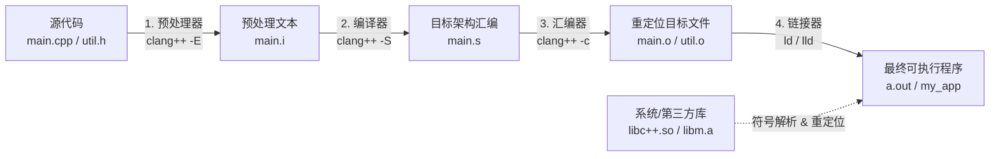
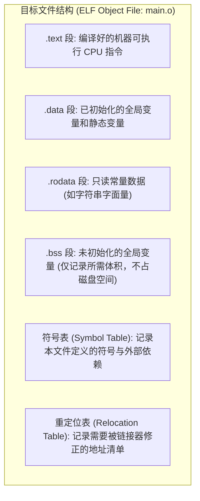
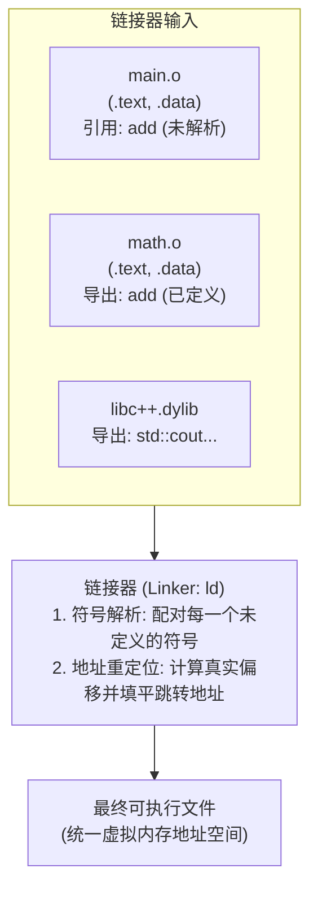

# 1.2.1 预处理、编译、汇编与链接

理解 translation phases 以及各阶段的输入、输出和职责。

---

## 导航

← 上一节：[1.2 编译、链接与程序构建模型](../index.md)
↑ 返回上级：[1.2 编译、链接与程序构建模型](../index.md)
下一节：[1.2.2 声明、定义与 One Definition Rule](../02_声明_定义与_one_definition_rule/index.md) →

---

## 1. 构建流水线全景图（The Big Picture）

在很多高级语言（如 Python、JavaScript）中，代码是由解释器边解析边执行的；而在现代 C++ 中，为了追求极致的运行期性能和确定的内存布局，源代码在运行之前必须经历一套严密而复杂的**多阶段静态构建流水线**。

从人类可读的文本代码（`.cpp` / `.h`）到操作系统内核可加载执行的二进制机器码文件，标准流程划分为经典的**四大核心阶段**：



### 构建阶段、输入产物与常用命令对照表

| 构建阶段 | 执行工具 | 主要输入 | 产出成果 | 典型编译器参数 | 阶段核心职责 |
| :--- | :--- | :--- | :--- | :--- | :--- |
| **1. 预处理 (Preprocessing)** | 预处理器（cpp） | `.cpp`, `.h` | `.i`（展开后的纯文本） | `clang++ -E` | 纯文本替换、头文件嵌入、宏展开、条件编译裁剪 |
| **2. 编译 (Compilation)** | 编译器前端+后端（cc1plus） | `.i` | `.s`（人类可读汇编文本） | `clang++ -S` | 语法/语义分析、类型检查、常量折叠与指令级优化 |
| **3. 汇编 (Assembly)** | 汇编器（as） | `.s` | `.o` / `.obj`（二进制目标文件） | `clang++ -c` | 汇编助记符转机器码、构建节区与未重定位符号表 |
| **4. 链接 (Linking)** | 链接器（ld / lld / link） | 多个 `.o`, 库文件 | 可执行文件 / 动态库 / 静态库 | 默认直接生成或 `-o` | 跨编译单元**符号解析**与虚拟内存地址**重定位** |

> [!NOTE]
> 平时我们执行的 `clang++ -O2 main.cpp -o app` 实际上是一个**驱动程序（Driver）**，它在幕后自动帮我们依次串联调用了上述四个独立的工具。

---

## 2. 第一阶段：预处理（Preprocessing）

预处理器是一个**纯文本级别的字符流处理器**。它的工作极为机械，**对 C++ 的语法结构、类型系统、作用域和面向对象完全一无所知**。

### 核心任务与行为

1. **头文件展开（`#include`）**：
   - 当遇到 `#include <vector>` 或 `#include "my_header.h"` 时，预处理器会找到对应磁盘文件，将其全部文本**原封不动地直接复制粘贴**到当前指令所在的位置；
   - 这也是为什么包含大型头文件会导致编译单元暴涨到几万甚至数十万行的原因。
2. **宏定义与文本替换（`#define`, `#undef`）**：
   - 将代码中所有宏名称无差别替换为对应的文本内容；
   - 计算宏连接操作符 `#`（字符串化）与 `##`（符号拼接）。
3. **条件编译（`#ifdef`, `#ifndef`, `#if`, `#elif`, `#endif`）**：
   - 根据宏是否存在或表达式真假，动态保留或彻底剔除整块代码。常用于跨平台适配、调试开关与版本适配。
4. **清理与元标记**：
   - 剥离所有单行 `//` 和多行 `/* */` 注释，将其替换为一个空格；
   - 插入行标记（Line Markers，形如 `# 12 "my_header.h" 2`），以便后续编译报错时能精准提示源代码的真实文件名与行号。

### 动手观察预处理产物

```bash
# 仅执行预处理，查看展开后的代码
clang++ -E main.cpp -o main.i
```
打开 `main.i` 会发现，原本只有十几行的 `main.cpp`，因为 `#include <iostream>` 的展开而变成了数万行极其庞大的纯文本。

---

## 3. 第二阶段：编译（Compilation）

编译是整个工具链中**最复杂、耗时最长且最核心的阶段**。它负责把预处理生成的纯文本（正式称为**编译单元，Translation Unit**），翻译为针对特定硬件架构（如 x86-64 或 ARM64）的汇编指令。


### 经典三段式编译架构（Three-Phase Design）

以现代 LLVM/Clang 和 GCC 为代表，编译器分为三层：
1. **编译器前端（Frontend，如 Clang）**：
   - **词法分析（Lexing）**：将字符流解析为 Token（如关键字 `int`、标识符、字面量）；
   - **语法分析（Parsing）**：根据 C++ 语法规则将 Token 组织为**抽象语法树（AST）**；
   - **语义分析（Sema）**：进行作用域查找、重载决议（Overload Resolution）、模板实例化、C++20 Concepts 契约检查与访问控制权限校验。若有错误直接报出编译错误。
2. **编译器中端（Optimizer）**：
   - 将 AST 转换为硬件无关的**中间表示（LLVM IR）**；
   - 执行数以百计的极其激进的优化 Passes：内联函数展开、消除未调用的函数（DCE）、循环不变量外提、SIMD 自动向量化等。
3. **编译器后端（Target Backend）**：
   - 针对具体的目标芯片架构（如 Intel Core i9 或 Apple M3），进行指令映射、寄存器智能分配与流水线乱序执行调度，最终生成清晰的文本汇编代码文件（`.s`）。

```bash
# 生成人类可读的汇编代码
clang++ -S -O2 main.cpp -o main.s
```

---

## 4. 第三阶段：汇编（Assembly）

汇编器的职责非常专一且明确：**将汇编指令（如 `movl`, `addl`, `callq`）一对一转译为机器 CPU 能够直接读取解码的二进制操作码（Opcode）**。

### 重定位目标文件（`.o` / `.obj`）的诞生

汇编完成后输出的是**可重定位目标文件（Relocatable Object File）**（Linux/Android 下为 ELF 格式，macOS/iOS 下为 Mach-O 格式，Windows 下为 PE/COFF 格式）。

目标文件并非一堆混乱的机器码，而是按照规范划分了严密的**节区（Sections）**：



### 什么是未解析符号？

此时，每个 `.o` 文件都是孤立编译出来的。如果 `main.cpp` 调用了定义在 `math.cpp` 中的 `add(1, 2)`：
- 汇编器在编译 `main.cpp` 时，根本不知道 `add` 函数将来会被放在内存的哪个绝对地址；
- 于是汇编器会**在机器指令的跳转位置暂时填入占位符（如 `0x00000000`）**；
- 同时在**符号表（Symbol Table）**中记录：*“我需要一个名为 `_Z3addii` 的函数符号，目前状态是未解析（Undefined，标记为 `U`）”*，交给下一步的链接器处理。

```bash
# 编译汇编生成目标文件
clang++ -c main.cpp -o main.o

# 查看目标文件中的符号表（nm 工具）
nm main.o
```

---

## 5. 第四阶段：链接（Linking）

链接器是构建流水线的“总装车间”。它的使命是：**将分散在各个独立 `.o` 文件中的代码段和数据段合并起来，并把各个目标文件与引用的静态库、动态库缝合成一个能在操作系统中独立运行的整体**。



链接器内部执行两大核心步骤：

### 5.1 符号解析（Symbol Resolution）
- 链接器遍历所有输入的 `.o` 文件和库文件；
- 将每个 `.o` 中**未定义的符号（Undefined）**与提供该符号定义的 `.o` 进行全局名字配对；
- **错误排查**：
  - 如果某个符号在所有输入文件中都找不到提供者，链接器抛出著名的：`undefined reference to 'xxx'`；
  - 如果在多个不同的普通 `.o` 中找到了同名非虚、非内联符号的重复强定义，链接器抛出：`duplicate symbol / multiple definition of 'xxx'`。

### 5.2 地址重定位（Relocation）
- 在完成符号配对后，链接器把所有 `.o` 的 `.text` 代码段拼接合并成一个单一的代码段，把所有的 `.data` 合并成单一的数据段；
- 链接器为所有的函数和全局变量计算出最终在虚拟内存空间中的**绝对或相对偏移地址**；
- 链接器回头扫描各个 `.o` 的**重定位表**，把之前汇编器暂填的占位符（`0x00000000`）**精准改写替换为函数的真实内存调用地址**。

---

## 6. 构建错误分期诊断速查手册

当项目编译报错时，根据错误信息精准判断其发生在构建的哪一个阶段，是每个合格 C++ 工程师的基本功：

| 错误特征示例 | 发生阶段 | 根本原因 | 解决排查方向 |
| :--- | :--- | :--- | :--- |
| `fatal error: 'xxx.h' file not found` | **预处理期** | 头文件包含路径错误，磁盘找不到该头文件 | 检查头文件拼写、检查 `-I` 包含目录配置 |
| `macro expansion error` / `#error xxx` | **预处理期** | 宏定义条件触发主动报错或括号不匹配 | 检查宏定义分支、环境预设宏 |
| `error: expected ';' after expression` | **编译期** | 语法错误，违反 C++ 语言语法定义 | 根据报错行号修正标点或拼写 |
| `error: no matching function for call` | **编译期** | 重载决议失败，参数类型与函数签名不匹配 | 检查传参类型、查看候选函数签名 |
| `error: constraints not satisfied` | **编译期** | C++20 Concepts 契约检查未通过 | 检查传入类型是否满足 `requires` 约束条款 |
| `undefined reference to 'Foo::bar()'` | **链接期** | 声明了函数并在代码中调用，但**缺少函数实现** | 检查是否漏编译了对应的 `.cpp` 文件；检查是否漏链接了库（如 `-lpthread`） |
| `multiple definition of 'global_var'` | **链接期** | 违反单一定义原则（ODR），多处重复定义 | 在头文件中变量声明前增加 `inline` 或 `extern` |

---

## 7. 现代 C++ 的演进：Modules（模块）对流水线的革新

在传统的构建模型中，**预处理器的 `#include` 是导致大型 C++ 项目编译极其缓慢的罪魁祸首**（一个大头文件被 1000 个源文件引用，就必须在预处理期被重复展开 1000 次，编译器也必须重复解析其语法树 1000 次）。

C++20 引入的 **Modules（模块）** 打破了长达 40 年的传统预处理模型：
- 模块不再依赖粗暴的文本复制，而是将模块编译为**预编译二进制接口文件（BMI，如 `.pcm` / `.ifc`）**；
- 模块只会被编译器解析编译**一次**，后续导入（`import`）直接加载 AST 语义符号，极大提升了大型工程的编译吞吐量，同时彻底消除了宏污染。

在掌握了整个构建流水线的大致脉络后，下一小节我们将聚焦于连接编译与链接的核心法则——**1.2.2 声明、定义与 One Definition Rule（ODR）**。
