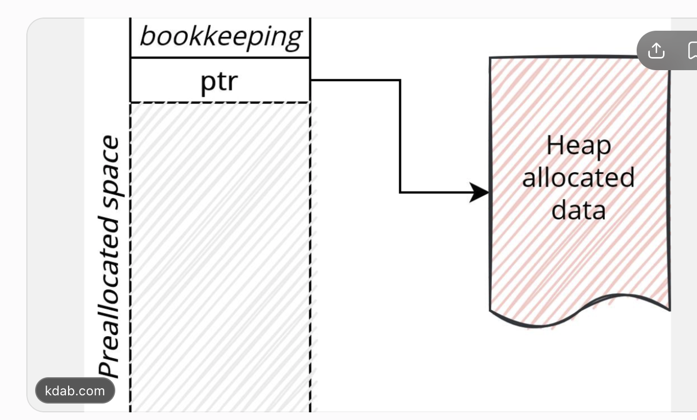

# 1.7 C++ 的 std::aligned_storage，以及与它相关的 alignas

**介绍**: 这两个概念经常一起出现，但作用不同。

它们属于 C++ 底层内存管理、对象生命周期和模板元编程的重要知识。

## 1. 首先理解：为什么需要内存对齐？

CPU 访问内存时，某些类型要求对象必须放在特定边界的地址上。

例如：
```cpp
struct Data {
    int    a;
    double b;
};
```

假设：

```cpp
alignof(int)    // 通常是 4
alignof(double) // 通常是 8
```

那么 double 对象的地址必须是 8 的倍数。

这就是 Alignment（内存对齐）。

### 1.1 alignof：查询对齐要求

C++11 引入：

```cpp
#include <iostream>

struct Data {
    int a;
    double b;
};

int main() {
    std::cout << alignof(int) << '\n';
    std::cout << alignof(double) << '\n';
    std::cout << alignof(Data) << '\n';
}
```

alignof(T) 返回类型 T 的对齐要求，单位是字节。


### 1.2 alignas：指定对齐要求

C++11 引入：

```cpp
struct alignas(64) CacheLine {
    int value;
};
```
这表示要求 CacheLine 至少按照 64 字节边界对齐。


例如：
```cpp 
CacheLine data; 
std::cout << alignof(CacheLine) << '\n';
```

通常输出：

```cpp
64
```


注意：alignas 是指定对齐要求，alignof 是查询对齐要求。

## 2. 什么是 std::aligned_storage？

**C++23 已弃用**

std::aligned_storage 是 C++11 引入的一个模板工具。
它的核心作用：
提供一块具有指定大小和对齐要求的原始存储空间，用来容纳某种类型的对象。
它本身不负责创建对象，也不负责调用构造函数。

例如：

```cpp
#include <type_traits>

struct Widget {
    int value;
    Widget(int v) : value(v) {}
};

using Storage = 
    std::aligned_storage<sizeof(Widget),alignof(Widget)>::type;

int main() {
    Storage buffer;
}
```

这里发生了什么？
- sizeof(Widget)：需要多少字节。
- alignof(Widget)：需要什么对齐。
- std::aligned_storage：生成满足这两个要求的存储类型。
- buffer：实际分配了一块原始存储空间。
但此时：

buffer 里面还没有 Widget 对象！

这点非常重要。

## 3. 如何在这块内存中创建对象？

以前经常使用 Placement New（定位 new）。

```cpp
#include <iostream>
#include <new>
#include <type_traits>

struct Widget {
    int value;

    Widget(int v) : value(v) {
        std::cout << "Widget constructed\n";
    }

    ~Widget() {
        std::cout << "Widget destroyed\n";
    }
};

int main() {
    using Storage = std::aligned_storage<
        sizeof(Widget),
        alignof(Widget)
    >::type;

    Storage buffer;

    Widget* p = new (&buffer) Widget(42);

    std::cout << p->value << '\n';

    p->~Widget();
}
```

执行过程：

1. 分配原始存储空间

```cpp
   Storage buffer;
```

   有足够的空间和正确的对齐，但还没有 Widget 对象。

2. Placement New

```cpp
   new (&buffer) Widget(42);
```

   在已有存储空间中调用 Widget 构造函数，开始对象生命周期。

3. 使用对象

```cpp
   p->value
```

   此时可以通过指针访问 Widget。

4. 显式析构
   
```cpp
   p->~Widget();
```

   结束 Widget 对象生命周期，但不释放底层存储空间。

这里要区分两个概念：
- Storage lifetime：存储空间的生命周期。
- Object lifetime：对象的生命周期。
它们并不一定同时开始或结束。

### 4. 为什么需要 aligned_storage？

它在早期 C++ 模板库中非常有用。

例如，实现一个固定容量的容器：

```cpp
template<typename T, std::size_t N>
class StaticVector {
    // 不使用 std::vector，不进行动态内存分配
};
```

我们希望：
1. 一次性准备 N 个对象的存储空间。
2. 只有真正插入元素时才构造对象。
3. 删除元素时调用析构函数。
4. 不需要动态分配内存。

这就是典型的 Fixed Capacity Container（固定容量容器）。

它也曾经用于：

```cpp
- std::vector 的底层实现思路
- std::optional 的早期实现
- Object Pool
- Small Buffer Optimization（SBO）
- Lock-free Data Structures
```

注意：这些是相关的实现技术，并不意味着现代标准库一定使用 aligned_storage。

### 5. C++23 为什么弃用了 aligned_storage？

因为它的使用比较容易出错，尤其涉及对象生命周期和类型安全。

现代 C++ 推荐根据实际用途使用以下技术：

|技术|用途|
|-|-|
|alignas|指定对齐要求|
std::byte|原始字节存储
std::array|固定容量存储
std::construct_at|在指定地址构造对象
std::destroy_at|销毁指定对象
std::launder|在特定对象生命周期场景中获取有效指针


例如，现代 C++ 可以这样写：

```cpp
#include <cstddef>
#include <memory>
#include <new>

struct Widget {
    int value;

    Widget(int v) : value(v) {}
};

int main() {
    alignas(Widget)
    std::byte buffer[sizeof(Widget)];

    Widget* p = std::construct_at(
        reinterpret_cast<Widget*>(buffer),
        42
    );

    std::destroy_at(p);
}
```

这里：
- alignas(Widget) 保证 buffer 的对齐要求。
- std::byte 提供原始存储空间。
- std::construct_at 构造对象。
- std::destroy_at 销毁对象。
std::construct_at 和 std::destroy_at 是 C++20 引入的。

### 6. 版本演进
C++ 标准|技术|作用
-|-|-
C++11|alignas|指定对齐
C++11|alignof|查询对齐
C++11|std::aligned_storage|提供对齐存储类型
C++17|std::byte|原始字节类型
C++20|std::construct_at|显式构造对象
C++20|std::destroy_at|显式销毁对象
C++23|std::aligned_storage|正式弃用

### 7. 一个非常重要的知识点：SBO



Small Buffer Optimization（小缓冲区优化）是现代 C++ 中非常重要的技术。

例如，std::string 在某些实现中会在对象内部直接保存短字符串，而不是每次都进行 heap allocation。

原理就是：
1. 在对象内部预留一块小型存储空间。
2. 小对象直接在这块空间构造。
3. 超过容量时才进行动态内存分配。
它和 aligned_storage 的设计思想有密切联系。

### 8. 建议你重点掌握的区别
概念|回答的问题
-|-
sizeof(T)|要多少存储空间？
alignof(T)|地址需要满足什么对齐？
alignas(N)|如何指定对齐？
aligned_storage|如何获得指定大小和对齐的原始存储？
Placement New|如何在已有存储中构造对象？
construct_at|如何通过标准库接口构造对象？
destroy_at|如何结束对象生命周期？

我建议下一步深入研究一个真正有价值的例子：

实现一个 StaticVector<T, N>，不使用 std::vector，不进行堆内存分配，使用 alignas、std::byte、construct_at 和 destroy_at 管理对象生命周期。

这个例子能把内存对齐、对象生命周期、模板元编程和 RAII 几个知识点真正串起来。


---

## 导航

- **上一层**：[1_cpp11](../index.md)
- **前一节**：[1.6 `std::atomic`：`compare_exchange_weak` 与 `compare_exchange_strong`](../1.6_atomic_compare_and_swap/index.md)
- **后一节**：[2 standard library additions and improvements](../../2_standard_library_additions_and_improvements/index.md)
