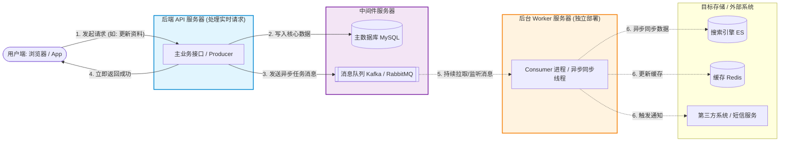
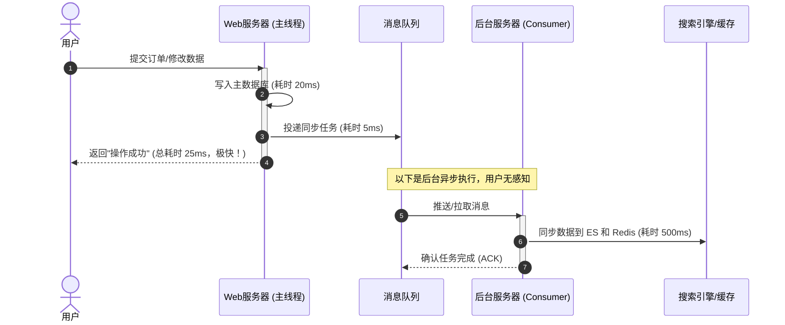

# 1.1.1.10 Entitlement System 架构图

**介绍**: Entitlement System 架构图

# 异步同步线程 / Consumer 深度解析

在现代后端架构和分布式系统中，**“异步同步线程”**或**“Consumer（消费者）”**是实现系统解耦、削峰填谷和最终一致性的核心组件。

---

## 1. 它们到底是什么？

简单来说，它们是**在后台默默干活的“搬运工”或“处理员”**。

### 核心概念拆解
* **为什么叫“异步”？**
  用户发起请求（比如“下单”或“修改个人资料”）后，主程序只完成最核心的动作（写入主数据库），然后**立刻**告诉用户“操作成功”，不需要等所有衍生操作（如发短信、同步数据到搜索引擎、更新缓存）全部做完。这些后续操作被丢到后台慢慢处理，这就叫**异步**。
* **为什么又叫“同步”？（此“同步”非彼“同步”）**
  这里的“同步”指的是**数据同步（Data Synchronization）**。比如：把 MySQL 里的数据同步到 Elasticsearch（搜索引擎）或 Redis（缓存）中，或者把 A 系统的数据同步到 B 系统。
* **线程 vs Consumer（消费者）**
  * **异步同步线程（进程内实现）：** 在同一个应用程序内部，通过线程池（Thread Pool）或内存队列开启的后台线程，专门用来跑这些异步任务。
  * **Consumer / 消费者（分布式实现）：** 当系统变大，通常会引入专业的信息队列（MQ，如 Kafka、RabbitMQ、RocketMQ）。负责从队列里拉取消息并执行具体业务逻辑的程序或进程，就叫做 **Consumer**。

---

## 2. 它们运行在哪里？

**答案是：它们运行在后端服务器（应用服务器或独立的 Worker 服务器）上。** 绝对不会运行在用户的浏览器或手机 App 里。

根据架构规模的不同，它们的具体部署位置通常有两种形态：

### 形态一：混合部署（中小型项目 / 进程内线程）
它们和你的主业务代码（Web API）打包在一起，运行在**同一台后端服务器**的同一个进程中（只是占用了不同的后台线程）。

### 形态二：独立部署（中大型分布式项目 / 独立 Consumer 节点）
为了防止后台同步任务吃光 CPU 和内存，拖垮用户的正常访问，架构师会把 Consumer 拆分成独立的服务，部署在**专门的后台服务器（Worker 节点）**上。

---

## 3. 架构与运行位置示意图

下面通过 Mermaid 流程图展示这两种架构在服务器上的实际运行位置与数据流向：

### 架构全景图（分布式 Consumer 模式）

### 时序对比图（为什么需要它？）

## “独立 Consumer 服务”之所以叫 Consumer（消费者），核心来自生产者-消费者模型（Producer-Consumer Pattern）以及消息队列 / 事件流架构的视角分工。

### 核心原因

相对“生产者（Producer）”的角色定义： 在异步解耦架构中，产生事件、任务或数据的服务叫 Producer（生产者），负责读取、处理或消费这些数据的服务就叫 Consumer（消费者）。
关注“谁消耗数据”，而非“谁部署在哪里”： 即使它是一个独立进程、独立微服务甚至独立服务器集群，只要它的核心职责是从队列、Topic 或事件流中拉取/接收消息并执行业务逻辑（如写库、发通知、算指标），在消息流转语义上它就是 Consumer。

### 与“订阅者 / Worker”的语境差异：

Consumer： 侧重消息队列/流语义，强调从 Broker/Topic 消费消息、维护消费位点（Offset）以及多实例之间的负载均衡（如 Kafka Consumer Group）。
Worker： 侧重任务执行语义，常见于后台作业队列（如 Celery、Sidekiq、Redis 队列），强调拉取任务并干活。
Subscriber： 侧重 Pub/Sub（发布-订阅）广播语义，强调按主题订阅事件。

### 为什么强调“独立 Consumer 服务”

#### 解耦与削峰： 
Producer 只管快速投递消息，不等待下游处理完成；
独立 Consumer 按自己的处理能力拉取消息，避免突发流量直接打垮下游数据库或核心接口。

#### 独立扩缩容与故障隔离： 
消费逻辑变慢或异常时，只需独立扩容 Consumer 实例或排查该服务，不会直接拖死 Producer 或其他业务服务。

## 独立 Consumer 按自己的处理能力拉取消息，避免突发流量直接打垮下游数据库或核心接口

这句话说的是消息队列架构中“削峰填谷”和“反压/速率控制”的核心机制。用大白话拆解，就是：**下游干活慢、扛不住瞬时高峰时，让独立 Consumer 自己控制节奏慢慢拿活干，别一口吞下太多把下游撑爆。**
下面用**饭店后厨**做个类比，再对应到**系统架构**中看具体怎么运作：

### 1. 通俗类比：前台接单 vs. 后厨出餐

* **突发流量（比如饭点突然涌进 200 桌客人）：** 前台（**Producer**）飞快接单，把订单全扔进“待做订单篮”（**消息队列 / Broker**）。
* **如果直接冲向后厨（下游数据库或核心接口）：** 后厨灶台有限、厨师只有几个人，一下子涌进 200 单，要么排队积压超时，要么数据库连接池耗尽、CPU 打满甚至宕机。
* **独立 Consumer 按自己的能力拉取：** 后厨这边有一个独立的接单员/配菜组（**独立 Consumer**），它看一眼灶台还有几个空位、当前处理耗时是多少，**每次只从订单篮里拿自己能消化的一批单子**（比如每次拉 10 条），做完一批再拉下一批。多出来的订单先安静躺在队列里排队。

### 2. 对应到系统里，具体是怎么实现的？

在 Kafka、RabbitMQ、SQS 等消息系统中，“按自己的处理能力拉取”通常靠以下几个机制配合：

* **Pull 拉取模式（主动要活，而不是被灌活）：**
Consumer 处于空闲或处理完当前批次后，才向 Broker 发送拉取请求（如 `poll()`）。下游慢的时候，Consumer 少拉、慢拉，不会被动接收超出承受能力的洪峰。

* **批量大小（Batch Size）与并发度控制：**
每次只拉取固定数量的消息（例如一次拉 50 条），或者固定线程池大小（例如 8 个工作线程），保证同一时刻打向数据库或下游接口的并发请求数是有上限的。

* **背压 / 限流与重试退避：**
如果发现下游数据库响应变慢、报超时或连接池吃紧，Consumer 可以**降低拉取频率、暂停拉取或延迟重试**，给下游喘息和恢复的时间。

* **消息队列充当“缓冲池”：**
突发流量期间，积压的消息暂存在 Broker 磁盘或内存中（只要队列容量和保留策略扛得住），等流量高峰过去，Consumer 再慢慢把积压消息消化完——这就是“削峰填谷”。

### 3. 为什么强调“独立 Consumer”？

如果消费逻辑和主业务服务混在一起，或者和核心接口共用同一批资源：

1. **资源会互相抢占：** 突发消费导致 CPU、内存或线程池飙升，可能直接连累上游接单接口也变慢甚至不可用。
2. **扩缩容不灵活：** 下游数据库扛不住时，你希望的是精准控制 Consumer 的消费速率或单独调整 Consumer 实例数，而不是把整个业务系统一起动。

### 一句话总结

**Producer 负责“快速收下请求并丢进队列”，队列负责“先存着别丢”，独立 Consumer 负责“看准下游的胃口，一口一口往下喂”。** 这样既不会丢请求，也不会把下游数据库或核心接口瞬间冲垮。

---

## 4. 总结对比

| 维度 | 进程内异步线程 | 独立 Consumer 服务 |
| :--- | :--- | :--- |
| **运行位置** | **Web 应用服务器**内部（与接口共用机器） | **独立的 Worker 服务器**（与接口隔离） |
| **依赖组件** | 语言自带线程池、内存队列（如 Java `BlockingQueue`） | 外部消息中间件（Kafka、RabbitMQ、Redis Stream） |
| **可靠性** | 较弱（服务器重启或宕机，内存里未处理的任务会丢失） | **极高**（消息持久化在 MQ 中，Consumer 挂了重启还能接着消费） |
| **适用场景** | 非核心日志记录、允许丢失的轻量级通知 | 订单状态流转、跨库数据同步（MySQL -> ES）、核心资金流水 |

---

## 导航

⬅️ 上一节：[1.1.1.09 在线权限系统：异步增量同步的生产级工程难点](1.1.1.09_Bloomberg_Entitlemene_QPS_Guess.md)
⏺️ 当前节：[1.1.1.10 Entitlement System 架构图](1.1.1.10_Entitlement_System_架构图.md)
➡️ 下一节：[1.1.1.11 Asynchronous Incremental Synchronization](../../../.meta/1.1.1.11_index.md)
⬆️ 返回上级：[1.1.1 Latency, Consistency & Security Trade-offs](../../../.meta/1.1.1_index.md)
