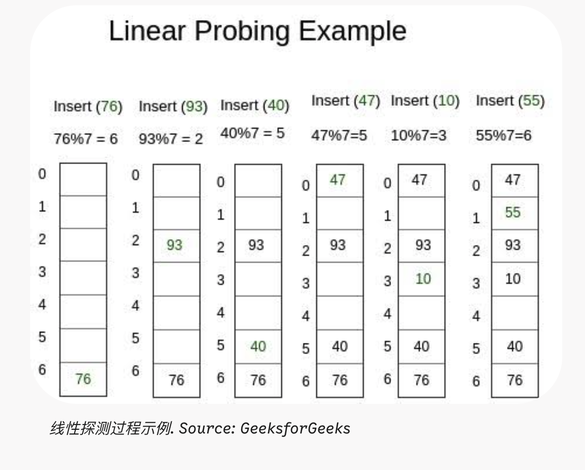

# 2.1.1 Hash Tables & Open Addressing（哈希表与开放寻址）

**介绍**: hash-tables-open-addressing

f
fdsa


---

## 为什么在 2M 记录量级关注开放寻址？

在千万级乃至亿级数据之前，**约 200 万条记录**是一个非常典型且实用的“单机热内存甜点区”：

* **全量驻留 L3 / 主存可行**：若单个索引条目控制在 8–24 字节，200 万条记录的底层槽位数组大约占 **16 MB – 64 MB**（计入负载因子余量）。只要避免频繁指针跳跃与堆碎片，单次点查通常只需 1–2 次缓存行读取（Cache Line Fetch），延迟可稳定在几十纳秒量级。
* **对比链地址法（Separate Chaining）**：传统链表法每个节点独立 `new` 分配，不仅带来额外的堆分配器开销与指针体积（8 字节），还会导致节点散落在内存各处，引发大量 L2/L3 Cache Miss 与 TLB 抖动；而开放寻址把所有元素直接存放在连续数组中，天然契合硬件预取与缓存行（通常 64 字节）加载。

---

## 核心原理与探测策略

开放寻址的核心思想是：**所有键值对均存放在同一张连续槽位数组中，当目标槽位已被占用时，按确定性的探测序列（Probe Sequence）寻找下一个可用槽位**。

### 常见探测方式对比

| 探测策略 | 探测步长公式 | 缓存局部性 | 聚集问题（Clustering） | 适用场景 |
| --- | --- | --- | --- | --- |
| **线性探测（Linear Probing）** | $(h(k) + i) \bmod M$ | **极佳**（连续内存访问，64B 缓存行可一次带入多个槽位） | 存在**一次聚集**（Primary Clustering），高负载下探测链变长 | 2M 级内存索引、小型紧凑结构体、对吞吐与延迟极敏感的场景 |
| **二次探测（Quadratic Probing）** | $(h(k) + c_1 i + c_2 i^2) \bmod M$ | 中等 | 缓解一次聚集，但存在**二次聚集**，且表长需满足特定数学条件以保证全覆盖 | 哈希分布一般、需降低长连续冲突簇的场景 |
| **双重哈希（Double Hashing）** | $(h_1(k) + i \cdot h_2(k)) \bmod M$ | 较弱（步长跳跃可能跨缓存行） | 聚集少，探测序列分散 | 键分布复杂、希望减少冲突链长度但能接受更多跨行访存的场景 |

在现代工业界实现（如 SwissTable / `absl::flat_hash_map`、Robin Hood 哈希）中，通常会结合 **SIMD / 分组元数据（Control Bytes）** 或**位移控制（Robin Hood / Backward Shift）**，在保持连续内存访问的同时压低平均探测长度。

---

## 2M 记录规模下的容量、负载因子与删除治理

### 1. 容量与负载因子（Load Factor）

设有效记录数为 $N = 2{,}000{,}000$，目标最大负载因子 $\alpha = N / M$（通常控制在 **0.5 ～ 0.8** 之间，视具体哈希表结构而定）：

* 若 $\alpha = 0.7$，所需槽位数 $M \approx 2{,}857{,}143$，向上取整到 2 的幂次（如 $2^{22} = 4{,}194{,}304$ 或 $2^{21} = 2{,}097{,}152$ 视阈值而定；若取 $2^{22}$ 槽位，实际负载率约 47.7%，探测极短但内存翻倍；若取 $2^{21}$ 槽位，负载率约 95.4%，冲突会急剧恶化）。
* **工程折中**：对于 2M 级索引，若每个槽位为 16 字节（例如 8B Key + 8B Payload/Index），$4 \times 10^6 \times 16\text{ B} \approx 64\text{ MB}$。在现代服务器上 64 MB 属于极小开销，用空间换取更低的探测次数与更稳定的 P99 延迟通常非常划算。

### 2. 删除操作：墓碑（Tombstone） vs. 后向移动（Backward Shift）

开放寻址不能直接把被删槽位清空为 `EMPTY`，否则会截断后续冲突元素的探测链：

* **墓碑标记（Tombstone）**：将槽位标记为 `DELETED`（墓碑）。查找时遇到墓碑继续向后探测；插入时可复用墓碑槽位。**缺点**是大量删除后墓碑堆积，会导致查找退化，即使有效元素不多也可能触发 Rehash/清理。
* **后向移动删除（Backward Shift Deletion）**：删除某个槽位后，将其后方连续簇中“自然哈希位置不在当前空位之后”的元素向前平移填补空洞，从而无需墓碑。**缺点**是实现细节稍复杂，且移动元素时需维护不变量。

---

## C++ 开放寻址索引示例（2M 级紧凑结构）

下面是一个面向 `uint64_t` 键到 `uint32_t` 记录偏移量（足够索引 40 亿条记录，适合 2M 记录场景）的简化开放寻址线性探测示例，演示槽位状态、探测与查找逻辑：

```cpp
#include <cstdint>
#include <vector>
#include <stdexcept>

class OpenAddressIndex {
public:
    enum class SlotState : uint8_t {
        Empty = 0,
        Occupied = 1,
        Tombstone = 2
    };

    struct Slot {
        uint64_t key = 0;
        uint32_t value = 0;
        SlotState state = SlotState::Empty;
    };

    explicit OpenAddressIndex(size_t expected_records, double max_load_factor = 0.7)
        : max_load_(max_load_factor) {
        size_t min_cap = static_cast<size_t>(expected_records / max_load_) + 1;
        capacity_ = next_pow2(min_cap < 16 ? 16 : min_cap);
        slots_.resize(capacity_);
    }

    bool insert(uint64_t key, uint32_t value) {
        if (static_cast<double>(size_ + tombstones_ + 1) / capacity_ > max_load_) {
            rehash(capacity_ * 2);
        }

        const size_t mask = capacity_ - 1;
        size_t idx = hash64(key) & mask;
        size_t first_tombstone = npos;

        while (true) {
            Slot& s = slots_[idx];
            if (s.state == SlotState::Occupied) {
                if (s.key == key) {
                    s.value = value; // 更新已有键
                    return false;
                }
            } else if (s.state == SlotState::Tombstone) {
                if (first_tombstone == npos) {
                    first_tombstone = idx;
                }
            } else { // SlotState::Empty
                size_t target = (first_tombstone != npos) ? first_tombstone : idx;
                if (slots_[target].state == SlotState::Tombstone) {
                    --tombstones_;
                }
                slots_[target] = Slot{key, value, SlotState::Occupied};
                ++size_;
                return true;
            }
            idx = (idx + 1) & mask;
        }
    }

    bool find(uint64_t key, uint32_t& out_value) const noexcept {
        const size_t mask = capacity_ - 1;
        size_t idx = hash64(key) & mask;

        while (true) {
            const Slot& s = slots_[idx];
            if (s.state == SlotState::Empty) {
                return false;
            }
            if (s.state == SlotState::Occupied && s.key == key) {
                out_value = s.value;
                return true;
            }
            idx = (idx + 1) & mask;
        }
    }

    bool erase(uint64_t key) noexcept {
        const size_t mask = capacity_ - 1;
        size_t idx = hash64(key) & mask;

        while (true) {
            Slot& s = slots_[idx];
            if (s.state == SlotState::Empty) {
                return false;
            }
            if (s.state == SlotState::Occupied && s.key == key) {
                s.state = SlotState::Tombstone;
                --size_;
                ++tombstones_;
                return true;
            }
            idx = (idx + 1) & mask;
        }
    }

    size_t size() const noexcept { return size_; }
    size_t capacity() const noexcept { return capacity_; }

private:
    static constexpr size_t npos = static_cast<size_t>(-1);

    static size_t next_pow2(size_t x) noexcept {
        --x;
        x |= x >> 1;
        x |= x >> 2;
        x |= x >> 4;
        x |= x >> 8;
        x |= x >> 16;
        if constexpr (sizeof(size_t) >= 8) {
            x |= x >> 32;
        }
        return x + 1;
    }

    // SplitMix64 混合函数，避免低位聚集
    static uint64_t hash64(uint64_t x) noexcept {
        x += 0x9e3779b97f4a7c15ULL;
        x = (x ^ (x >> 30)) * 0xbf58476d1ce4e5b9ULL;
        x = (x ^ (x >> 27)) * 0x94d049bb133111ebULL;
        return x ^ (x >> 31);
    }

    void rehash(size_t new_capacity) {
        std::vector<Slot> old_slots = std::move(slots_);
        capacity_ = new_capacity;
        slots_.assign(capacity_, Slot{});
        size_ = 0;
        tombstones_ = 0;

        for (const auto& s : old_slots) {
            if (s.state == SlotState::Occupied) {
                insert(s.key, s.value);
            }
        }
    }

    size_t capacity_ = 0;
    size_t size_ = 0;
    size_t tombstones_ = 0;
    double max_load_ = 0.7;
    std::vector<Slot> slots_;
};

```

---

## 2M 级索引落地时的工程注意事项

1. **哈希函数质量优先于取模花招**：当表大小为 $2^k$ 时，位掩码 `idx & (capacity_ - 1)` 极快，但会完全依赖哈希值的低 $k$ 位分布。务必使用雪崩效应良好的哈希函数（如 SplitMix64、Wyhash、XXH3 或 `std::hash` 进一步混合）。
2. **注意扩容停顿（Rehash Spike）**：在 2M–4M 槽位规模下，单线程 `rehash` 分配并重新插入约 200 万条记录通常只需数毫秒到十几毫秒，但在严格低延迟路径上仍应**预留充足初始容量**，避免运行期突发扩容。
3. **仅支持等值点查，不支持范围查询**：开放寻址哈希表适合 `Key -> RecordID/Payload` 的精确匹配与去重；若业务需要前缀扫描、区间统计或有序遍历，应搭配有序结构或位图索引（见下一节 `2.1.2 dense-integer-bitmaps`）。


---

## 导航

⬅️ 上一节：[1 architecture foundations](../../1_architecture-foundations/_index.md)
⏺️ 当前节：[2.1.1 Hash Tables & Open Addressing（哈希表与开放寻址）](2.1.1_hash-tables-open-addressing.md)
➡️ 下一节：[2.1.2 More_of_Open_Addressing_in_HashTable](2.1.2_More_of_Open_Addressing_in_HashTable.md)
⬆️ 返回上级：[2.1 indexing strategies 2m records](_index.md)
