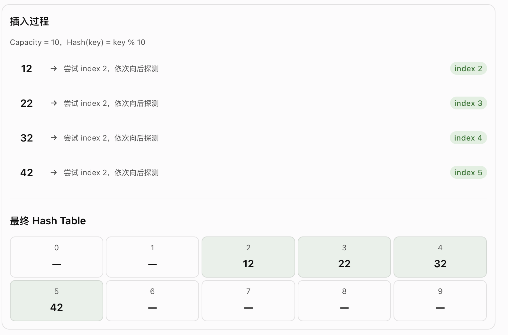

# 2.1.3 Open_addressing_in_hash_table

**介绍**: Open_addressing_in_hash_table

Open Addressing（开放寻址法）是 **Hash Table（哈希表）解决哈希冲突（Hash Collision）的一种方法**。

它是 Hash Table 中非常重要的一种实现技术，尤其是在追求高性能、低延迟（Low Latency）的系统中，例如 Bloomberg、数据库、内存缓存以及 C++ 高性能容器。

你可以把它理解为：

**当一个元素计算出来的 Hash 位置已经被占用了，不另外申请内存，而是在当前 Hash Table 的数组中继续寻找其他空位置。**

# **1. Open Addressing 是什么？**

假设我们有一个 Hash Table：

- 数组容量（Capacity）：10
- Hash 函数：`hash(key) = key % 10`

现在依次插入以下元素：

```
12, 22, 32, 42
```

它们的 Hash 值：

| Key | Hash(key) | 目标位置 |
| --- | --------- | ---- |
| 12  | 2         | 2    |
| 22  | 2         | 2    |
| 32  | 2         | 2    |
| 42  | 2         | 2    |

问题来了：四个元素都想放在 index 2。

这就是 Hash Collision。

Open Addressing 的解决方法是：

1. 首先尝试 Hash 计算出来的位置。
2. 如果位置已经被占用，就按照某种探测策略（Probing Strategy）寻找下一个位置。
3. 找到空位置后，直接放入数组。

例如使用 Linear Probing（线性探测）：



注意：这里的元素全部直接存储在 Hash Table 的数组内部，没有额外的链表节点。

这就是 Open Addressing 的核心思想。

# **2. 三种主要的 Probing Strategy**

Open Addressing 有三种经典的探测策略。

## **2.1 Linear Probing（线性探测）**

公式：

\\[ h(k,i)=(h(k)+i)\bmod m \\]

其中：

- \\(k\\)：Key
- \\(i\\)：第几次探测，从 0 开始
- \\(m\\)：Hash Table 容量
- \\(h(k)\\)：初始 Hash 位置

意思是：如果当前位置被占用，就依次向后寻找。

例如：

```
index = (hash(key) + i) % capacity;
```

[Learn Hash Table | Advanced Data Structures](https://images.openai.com/static-rsc-4/ANR3fQq7KGwMBT1y6DPKH_ZFROoFbQ3K-gljdRmqH5AVN-ce7KvlKgRfhke7j6GayAnNaEwpSU2_9w7b0ddkfhq1uSdhz1BvN1rnDTb55KnpIPa0srijCYcE-5nr7YHQkSk7SDkUgmTUWYJSxOl1Jh5khOi_gRYypU8t5n80Ktk?purpose=inline)

[codefinity.com](https://codefinity.com/courses/v2/212d3d3e-af15-4df9-bb13-5cbbb8114954/3a2558c0-2edb-4b98-a8d6-88b105cbcdda/415ad333-2a20-4b93-aa79-32beac2339bd?utm_source=chatgpt.com)

**优点：**

- 实现非常简单。
- 内存连续，Cache Locality 好。
- CPU Cache 命中率通常比较高。
- 不需要额外的节点分配。

**缺点：**

Primary Clustering（主聚集问题）。

什么意思？

假设 index 2、3、4、5 已经被占用。

新元素即使 Hash 到 index 3，也必须继续往后寻找。

这样容易形成越来越长的连续占用区域，导致查找性能下降。

## **2.2 Quadratic Probing（二次探测）**

为了解决 Linear Probing 的 Primary Clustering，引入二次探测。

公式：

\\[ h(k,i)=(h(k)+c_1i+c_2i^2)\bmod m \\]

例如：

```
index = (hash(key) + i * i) % capacity;
```

探测位置可能是：

```
Initial: 2

i = 0: 2
i = 1: 3
i = 2: 6
i = 3: 1
i = 4: 8
```

它不再连续地寻找下一个位置。

**优点：**

- 可以减少 Primary Clustering。
- 不需要额外内存。

**缺点：**

- 可能出现 Secondary Clustering。
- 某些容量和参数组合无法保证遍历整个 Hash Table。
- 实现时必须考虑容量和探测序列的数学性质。

Secondary Clustering 指的是：初始 Hash 值相同的 Key，会产生相同的探测序列。

## **2.3 Double Hashing（双重哈希）**

这是另一种非常重要的探测策略。

公式：

\\[ h(k,i)=(h_1(k)+i\cdot h_2(k))\bmod m \\]

它使用两个 Hash Functions：

- \\(h_1(k)\\)：决定初始位置。
- \\(h_2(k)\\)：决定每次探测的步长。

例如：

```
h1(key) = key % 10;
h2(key) = 1 + (key % 7);

index = (h1(key) + i * h2(key)) % 10;
```

假设：

```
key = 22

h1(22) = 2
h2(22) = 2

探测序列：

2 → 4 → 6 → 8 → 0 → ...
```

**优点：**

- 能显著减少 Primary Clustering。
- 能显著减少 Secondary Clustering。
- 探测位置分布通常比 Linear Probing 更分散。

**缺点：**

- 需要计算两个 Hash Functions。
- Cache Locality 通常不如 Linear Probing。
- 必须保证步长与表容量互质（Coprime），才能遍历所有槽位。

# **3. Open Addressing vs Separate Chaining**

这是两种 Hash Collision Resolution 的主要方法。

**Open Addressing**

[What is Hash and Hash Table · Maratom's Study Blog](https://images.openai.com/static-rsc-4/QnZHrlmjK07AbBQnq_hlPCqN3tXubL03p8m1oVwHhL1jLbWgILH7yh_VOLbc2MvGWYi94_1FeXYdShKsFlE8719ecrHDfjUbnmnQXFdJkffGyLQC1OJup4QzUL1YEs7PYx-OHJhYdOyEf_1hhlD8cMs71KaXy2hgqyvnYZ899mA?purpose=inline)

所有元素直接存储在数组内部，通过探测解决冲突。

**Separate Chaining**

[Perbandingan Kinerja Hashing dengan Teknik Probing dan Chaining | by Sita Maheswari | Medium](https://images.openai.com/static-rsc-4/gDrOH44Q8ZYyA0gvZ92usSgHpLG9aOD61uuTDljK0a8o1Exppi_GlDgrReFh4z07xFJbWNxbbAk4GZIZeZiZv65P6s8fUH0pAarj-8Cr6LFOSlwVeZnprkGFBG7PmFPShPRi_AGDUcEjQzSKcn2NFTSMNepLMPKG-syoZlKlGxo?purpose=inline)

每个 Bucket 保存一个链表或其他容器，冲突元素放在同一个 Bucket 中。

| 比较             | Open Addressing | Separate Chaining  |
| -------------- | --------------- | ------------------ |
| 存储位置           | 数组内部            | 数组 + 外部节点          |
| 内存分配           | 通常无需逐元素分配       | 通常需要节点分配           |
| Cache Locality | 通常较好            | 通常较差               |
| 删除             | 比较复杂            | 比较简单               |
| Load Factor    | 必须小于 1          | 可以大于 1             |
| 内存开销           | 通常较低            | 通常较高               |
| 冲突处理           | Probing         | Linked List / Tree |

# **4. Load Factor（负载因子）**

这是理解 Open Addressing 的一个关键概念。

定义：

\\[ \alpha=\frac{n}{m} \\]

其中：

- \\(n\\)：已经存储的元素数量。
- \\(m\\)：Hash Table 的容量。

例如：

```
Capacity = 100
Elements = 70

Load Factor = 0.7
```

对于 Open Addressing，Load Factor 非常重要。

因为它没有额外的链表空间。

当 Load Factor 越来越接近 1：

- 空闲槽位越来越少。
- 探测次数越来越多。
- 插入、查找性能都会明显下降。

因此，Hash Table 通常会在 Load Factor 达到某个阈值时进行扩容（Rehashing）。

例如：

```
if (size * 10 >= capacity * 7) {
    rehash();
}
```

这里的阈值是 0.7。

注意，0.7 并不是所有 Hash Table 都必须采用的固定值。

# **5. Open Addressing 中一个非常重要的问题：Deletion**

这是很多初学者容易忽略的地方。

假设采用 Linear Probing：

```
Index 2: 12
Index 3: 22
Index 4: 32
Index 5: EMPTY
```

现在删除 22。

如果直接把 index 3 设置成 EMPTY：

```
Index 2: 12
Index 3: EMPTY
Index 4: 32
Index 5: EMPTY
```

此时查找 32：

1. Hash(32) = 2。
2. index 2 找到 12。
3. index 3 是 EMPTY。
4. 认为 32 不存在。

但是 32 实际上还在 index 4！

因此，不能简单地将删除位置设置为 EMPTY。

解决方法是 Tombstone（墓碑标记）。

**三种 Slot State**

# **12**

**Occupied**

已占用

# **†**

**Deleted**

Tombstone

# **—**

**Empty**

真正的空槽位

- Occupied：存在元素。
- Deleted：以前存在元素，但已经删除，不能中断查找。
- Empty：从未使用过的空槽位，可以终止查找。

这三个状态在实现 Hash Table 时非常重要。

Tombstone 还有一个副作用：随着删除次数增加，墓碑越来越多，会影响性能。因此需要定期 Rehash，清理 Tombstones。

# **6. C++ 实现：Linear Probing**

下面给你一个简化的 C++ 实现，展示 Open Addressing 的核心逻辑。

```
#include <iostream>
#include <vector>
#include <optional>

template <typename K, typename V>
class HashTable {
private:
    enum class State {
        EMPTY,
        OCCUPIED,
        DELETED
    };

    struct Slot {
        State state = State::EMPTY;
        std::optional<K> key;
        std::optional<V> value;
    };

    std::vector<Slot> table;
    size_t size = 0;

    size_t hash(const K& key) const {
        return std::hash<K>{}(key) % table.size();
    }

public:
    explicit HashTable(size_t capacity)
        : table(capacity) {}

    void insert(const K& key, const V& value) {
        size_t index = hash(key);

        for (size_t i = 0; i < table.size(); ++i) {
            size_t pos = (index + i) % table.size();

            if (table[pos].state == State::OCCUPIED) {
                if (table[pos].key == key) {
                    table[pos].value = value;
                    return;
                }
                continue;
            }

            table[pos].key = key;
            table[pos].value = value;
            table[pos].state = State::OCCUPIED;
            ++size;
            return;
        }

        throw std::runtime_error("HashTable is full");
    }

    V* find(const K& key) {
        size_t index = hash(key);

        for (size_t i = 0; i < table.size(); ++i) {
            size_t pos = (index + i) % table.size();

            if (table[pos].state == State::EMPTY)
                return nullptr;

            if (table[pos].state == State::OCCUPIED &&
                table[pos].key == key) {
                return &(*table[pos].value);
            }
        }

        return nullptr;
    }
};
```

这是一个教学性质的简化版本，还没有实现：

- `erase()` 和 Tombstone。
- 自动扩容。
- Rehash。
- 异常安全和完善的对象生命周期管理。

它展示了最核心的 Probing 机制。

# **7. 为什么 Open Addressing 对 Low Latency 很重要？**

这个问题与你研究 Bloomberg Entitlement 的 Low Latency 技术直接相关。

Open Addressing 的优势主要来自 Memory Layout。

假设：

**Separate Chaining**

```
Bucket[0] ──→ Node ──→ Node
Bucket[1] ──→ Node
Bucket[2] ──→ Node ──→ Node ──→ Node
```

每个 Node 可能分散在不同的内存位置。

访问时可能发生：

- Pointer Chasing
- Cache Miss
- TLB Miss
- Dynamic Memory Allocation

而 Open Addressing：

```
[ ][ ][A][B][C][ ][D][ ][ ]
```

元素集中在连续数组中。

因此：

1. 更好的 Spatial Locality。
2. 更少的 Pointer Chasing。
3. 更少的内存分配。
4. 更好的 CPU Cache 利用率。

不过要注意：Linear Probing 在高负载因子下也会产生严重的聚集，性能可能急剧下降。

## **8. 进一步了解：现代 Hash Table 的优化**

[Implementing the Swiss Table in Swift | by Lukas Zima | MateeDevs | Jan, 2026 | Medium](https://images.openai.com/static-rsc-4/fhh7dM3vx4lcaAc5JE0b4F6SdMvpRM5ECaUhRnItSgpFw0pkr9Rz91azdLQuurdXIByzRUVHS8RnEE29-LFVo8qulaiuyFIFTUc9xAwv154ygzMyjxaKRBTMIyl4HNNWgl7YzFQWlKIpQSqqfHjVKyVuLdvuCM5J-o4_vWNZ9Hc?purpose=inline)

[Medium](https://images.openai.com/static-rsc-4/BjGAzjXQ29t3kV0GjCpzn-Be2g4ktvrazVSJ-FwxMJazJ6WigNQhPfCBVNCVbBjIh_1TInyBVPiJFMuKpkGuBE8iAl4J3viPEWO169XeU75Xcuy1OP9AtaScYu22cxz_AjLtF6-CgzHszu-Yr0A4ja-ppT28pN1uzwg2daCW5CU?purpose=inline)

[Faster ES|QL stats with Swiss-style hash tables - Elasticsearch Labs](https://images.openai.com/static-rsc-4/kd78UAUCk-2BKv8x5iKySYodwRFeYHtraxdbfBYIFHTKdmK7KpHLg21cCDl59OqdtXMVDPlFCTdLdTlo2VcMMvVEb9i6u2DDqUKTnmt5Zg0thcn1Xta_F_YVHUoSNr4rFS9lJDew0WKq5L1KO8LlTcv6EudtK7Adn4xhurlh6Q0?purpose=inline)

11

现代高性能 Hash Table 已经不只是简单的 Linear Probing。

值得研究的有：

| Hash Table               | 主要技术                             |
| ------------------------ | -------------------------------- |
| Abseil SwissTable        | SIMD、Control Bytes、Group Probing |
| F14                      | SIMD、Chunk-based probing         |
| Boost.Unordered flat_map | Open Addressing、Flat Storage     |
| robin-hood-hashing       | Robin Hood Hashing               |

特别值得研究的是：

**Robin Hood Hashing（罗宾汉哈希）**

它的核心思想是：

如果新元素距离自己的理想 Hash 位置比当前元素更远，那么可以让新元素占据当前位置，把原来的元素往后移动。

简单说：

> Steal from the rich, give to the poor.

它试图减少不同元素之间 Probe Length（探测长度）的差异，从而改善查找性能。

# **9. 建议你建立的知识体系**

如果把 Open Addressing 放进你的 C++ / Low Latency 教材，我建议按下面的结构组织：

```
Hash Table
│
├── 1. Hash Function
│
├── 2. Hash Collision Resolution
│   │
│   ├── Separate Chaining
│   │
│   └── Open Addressing
│       │
│       ├── Linear Probing
│       ├── Quadratic Probing
│       ├── Double Hashing
│       ├── Robin Hood Hashing
│       └── Cuckoo Hashing
│
├── 3. Load Factor
│
├── 4. Deletion and Tombstones
│
├── 5. Rehashing
│
└── 6. High Performance Hash Tables
    │
    ├── Cache Locality
    ├── SIMD
    ├── Control Bytes
    └── Memory Allocation
```

**我建议下一步重点研究 SwissTable。**

因为它把 Open Addressing、Cache Locality、SIMD、Metadata Filtering 结合在一起，是理解现代 C++ 高性能 Hash Table 的非常好的案例。尤其值得研究它为什么可以一次检查一组槽位，而不是一个一个地检查。


---

## 导航

⬅️ 上一节：[2.1.2 More_of_Open_Addressing_in_HashTable](2.1.2_More_of_Open_Addressing_in_HashTable.md)
⏺️ 当前节：[2.1.3 Open_addressing_in_hash_table](2.1.3_Open_addressing_in_hash_table.md)
➡️ 下一节：[2.1.4 dense integer bitmaps](2.1.4_dense-integer-bitmaps.md)
⬆️ 返回上级：[2.1 indexing strategies 2m records](../../.meta/2.1_index.md)
