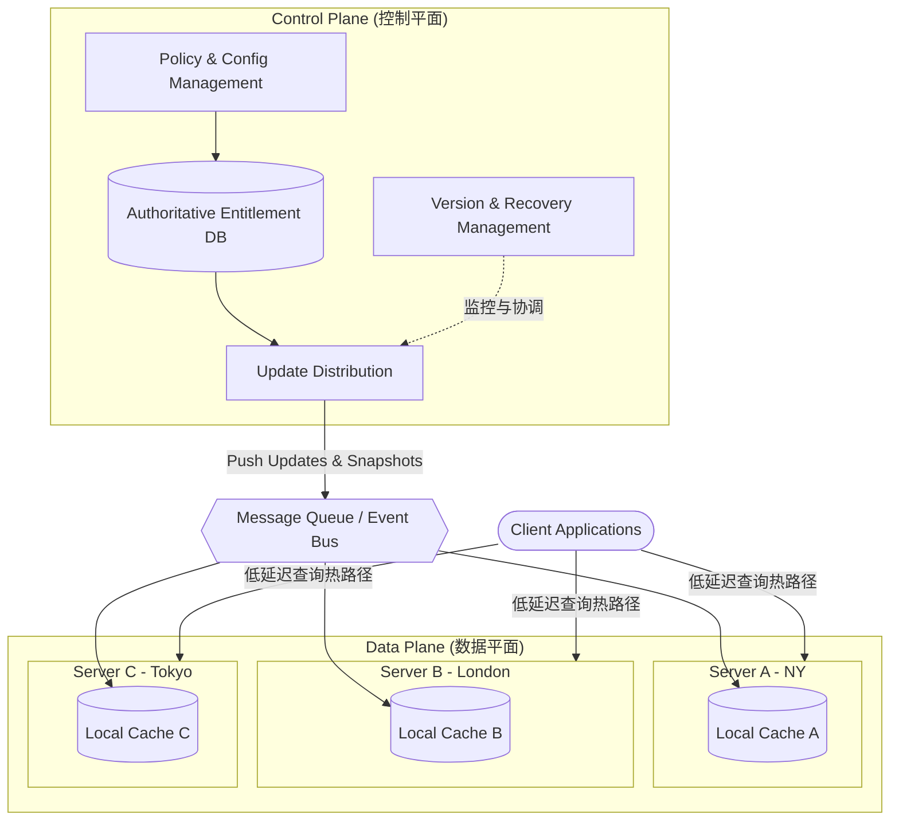

# 1.3.1 control plane responsibilities

**介绍**: control-plane-responsibilities

在**控制面与数据面分离**（Control / Data Plane Separation，对应紧随其后的 `1.2.2 data plane zero io hot path`）的架构中，**控制面（Control Plane）**负责“做决策、管状态、下发规则”，而**数据面（Data Plane）**专注于高频、低延迟的数据转发或请求处理。

控制面与数据面解耦后，控制面不再参与每一条热路径请求的逐包或逐请求处理，而是通过异步或批量机制将最新状态同步给数据面。

---

## 控制面的核心职责

* **配置管理与规则生成：** 接收外部声明式配置或策略变更（如路由表、限流阈值、灰度权重、访问控制列表），校验合法性后编译为数据面可快速执行的快照或规则集。
* **拓扑发现与服务注册：** 维护集群节点、实例上下线、健康检查状态及依赖关系，及时发现故障节点并计算新的可用路径或端点列表。
* **状态同步与增量下发：** 通过推送（Push）、长连接订阅或版本号比对，将变更后的配置与拓扑快照分发给数据面节点，同时避免全量抖动。
* **策略协调与一致性维护：** 处理多副本或分布式环境下的选主、租约、冲突解决与最终一致性收敛，确保全局视图相对统一。
* **可观测性与审计聚合：** 汇总来自数据面的指标上报、事件日志与状态回执，支撑监控告警、流量审计与故障排查。

---

## 控制面与数据面的边界对比

| 维度 | 控制面（Control Plane） | 数据面（Data Plane） |
| :--- | :--- | :--- |
| **核心任务** | 计算路由/策略、维护全局状态、下发配置 | 执行转发/处理、匹配规则、保障低延迟与高吞吐 |
| **执行频率** | 事件驱动或周期性（秒级、百毫秒级变更） | 极高频热路径（微秒级、逐请求/逐包执行） |
| **I/O 与计算特征** | 允许磁盘/网络 I/O、复杂计算与协调逻辑 | 追求零 I/O 或极少 I/O，避免锁竞争与阻塞 |
| **故障影响范围** | 短暂延迟或变更新增规则，通常不直接中断既有流量 | 直接影响在线业务吞吐量、尾延迟与可用性 |

理解控制面的职责边界，是设计下一节**数据面热路径零 I/O** 的前提：只有把慢操作、状态协调和重计算留在控制面，数据面才能保持确定性的高性能。


# 1.2.1 Control Plane Responsibilities（控制平面职责）

这一节在回答一个核心的系统架构设计问题：
**在一个高性能的 Bloomberg Entitlement System（权限系统）中，哪些事情应该由 Control Plane 负责，哪些事情不应该进入 Data Plane？**

下文将结合 Bloomberg Entitlement 的业务场景，特别是针对 **低延迟（Low Latency）** 需求进行深入拆解。

---

## 1. 什么是 Control Plane？

**Control Plane（控制平面）** 负责管理系统的状态、配置、策略和生命周期。它不直接处理每一次用户的实时权限查询，而是负责让系统明确以下核心状态：
- 当前有哪些用户？
- 当前有哪些权限？
- 哪些用户可以访问哪些资源？
- 权限数据什么时候更新？
- 哪些 Server 应该接收更新？
- 如何保证各个 Server 的数据最终一致？

### 拓扑示例
假设 Bloomberg 在全球有三个 Entitlement Server 节点：

```text
             Control Plane
                   |
          +--------+--------+
          |        |        |
       Server A Server B Server C
         (NY)   (London)  (Tokyo)
```

- **Control Plane** 负责管理权限数据，并将更新分发到各个 Server。
- **各个 Server（Data Plane）** 在本地内存中维护一份权限数据副本。

> **核心原则**：Control Plane 负责**管理和分发数据**，Data Plane 负责**使用数据**。

---

## 2. Control Plane 的六项核心职责

### 2.1 Configuration Management（配置管理）
负责管理系统运行所需要的全局及局部配置。

```cpp
struct EntitlementConfig
{
    int max_connections;
    int cache_size;
    int refresh_interval;
    bool enable_compression;
};
```

Control Plane 的具体动作包括：创建、修改、发布配置，管理配置版本，并将配置推送到各个节点：

```text
Control Plane
      |
      | Configuration v100
      |
      +--------> Server A
      |
      +--------> Server B
      |
      +--------> Server C
```

> **设计约束**：配置更新绝对不应该要求每一次权限查询都去访问 Control Plane，配置必须提前同步到本地。

### 2.2 Policy Management（策略管理）
这是 Entitlement System 最核心的职责之一。**Policy（策略）** 定义了“谁可以访问什么资源，以及在什么条件下可以访问”。

```text
User A
    |
    +---- Can access ----> Bloomberg Market Data
    |
    +---- Can access ----> NASDAQ Level 1
    |
    +---- Cannot access -> NASDAQ Level 2
```

在代码层面，可以将基础权限规则抽象为：

```cpp
struct Entitlement
{
    UserId user;
    ResourceId resource;
    bool allowed;
};
```

Control Plane 负责权限规则的增删改、版本管理以及变更分发。
*(注：这里的 `allowed` 只是简化模型。实际金融权限系统通常包含复杂的层级关系、产品组合、订阅条件和继承规则。)*

### 2.3 Data Distribution（数据分发）
这是连接 Control Plane 和 Data Plane 的核心桥梁。当用户权限发生变化时：

- **Before**: `User A -> Resource X -> ALLOWED`
- **After**: `User A -> Resource X -> DENIED`

Control Plane 产生一个带有版本号的更新事件，并通过 Message Queue 等中间件广播给所有 Data Plane 节点：

```cpp
struct EntitlementUpdate
{
    UserId user_id;
    ResourceId resource_id;
    bool allowed;
    uint64_t version;
};
```

```text
              Control Plane
                    |
              Update Event
                    |
          +---------+---------+
          |         |         |
       Server A Server B Server C
```

#### 分发模式对比

| 分发方式 | 工作原理 | 适用场景 |
| :--- | :--- | :--- |
| **Push-based（推送式）** | Control Plane 主动向节点发送增量更新 | 适合低延迟系统，能以最快速度传播变更 |
| **Pull-based（拉取式）** | Data Plane 定期向 Control Plane 请求更新 | 适合对实时性要求不高或网络环境受限的场景 |

> **工程实践**：在低延迟权限系统中，通常以 **Push** 为主，同时结合 **Snapshot（快照）、Pull 和定期校验**，防止网络抖动或消息丢失导致节点长期处于数据不一致状态。

### 2.4 Version Management（一致性版本管理）
在分布式环境下，不同节点的数据同步进度可能不一致。例如：
- `Server A`: Version 105
- `Server B`: Version 105
- `Server C`: Version 103 *(落后)*

如果此时 `Server C` 收到更新，需要通过版本号进行有序应用：

```cpp
void apply_update(const EntitlementUpdate& update)
{
    // 简化示意：过滤掉已应用的旧版本更新
    if (update.version <= current_version)
    {
        return;
    }

    // Apply update
}
```

**生产环境进阶考量**：
如果单个版本对应多条更新记录，不能简单地丢弃所有小于等于当前最大版本的消息。生产级系统通常需要引入以下机制：
- **Sequence Number（序列号）**：严格保证消息顺序。
- **Version Gap Detection（版本缺口检测）**：当 `Server B` 收到 `100 -> 101 -> 103` 时，能敏锐发现 `Missing 102!`。
- **Duplicate Detection（重复消息检测）**：保证幂等性。
- **Replay & Snapshot Recovery（消息重放与快照恢复）**：在检测到版本缺口时自动补齐数据。

### 2.5 Service Discovery（服务发现）
Control Plane 需要实时掌握集群拓扑与节点生命周期：
- 当前有哪些 Entitlement Server 在线？
- 哪些 Server 运行正常，哪些已下线？
- 新 Server 扩容加入后如何安全地获取初始全量数据？

```text
             Service Registry
                    |
          +---------+---------+
          |         |         |
       Server A Server B Server C
         Alive    Alive     Dead
```

**新节点上线标准流程（以新启动的 Server D 为例）**：
1. 向 Service Registry 注册服务（状态标记为 `Not Ready`）。
2. 从存储或 Control Plane 获取初始全量 **Snapshot**。
3. 追赶并应用生成 Snapshot 之后的增量更新（Incremental Updates）。
4. 确认本地数据版本与集群一致，进入可服务状态。
5. 标记为 **Ready**，开始接入外部查询流量。

> **核心原则**：Server 必须在本地数据初始化完成之后，才进入 `Ready` 状态，杜绝“缓存为空却对外提供服务”引发的误拒绝（False Deny）。

### 2.6 Monitoring and Recovery（监控与恢复）
Control Plane 持续监控各个 Data Plane 节点的运行健康度与数据同步状态：

| 监控指标 | 业务与工程含义 |
| :--- | :--- |
| **Current Version** | 节点当前本地缓存的权限数据版本号 |
| **Update Lag** | 节点版本与全局最新版本的滞后差距/时间延迟 |
| **Queue Depth** | 本地待消费更新消息队列的积压深度 |
| **Server Health** | 节点 CPU、内存、心跳及响应延迟健康状态 |
| **Cache Size** | 本地权限缓存占用的内存大小 |
| **Snapshot Status** | 最近一次快照加载或生成的执行状态 |

当监控发现 `Server C`（Version 195）严重落后于主版本（Version 200）时，触发自动恢复状态机：

```text
Detect Lag ──> Request Recovery ──> Download Snapshot ──> Apply Incremental Updates ──> Ready
```

---

## 3. Control Plane 与 Data Plane 职责对比表

| 核心职责 | Control Plane（控制平面） | Data Plane（数据平面） |
| :--- | :--- | :--- |
| **配置管理** | 负责创建、修改、发布与版本控制 | 接收配置并应用到本地运行时 |
| **权限规则管理** | 负责规则的增删改与逻辑编排 | 仅使用编译/解析后的权限数据 |
| **权限数据分发** | 负责生成更新事件并推送分发 | 接收更新事件并反序列化 |
| **版本管理** | 负责全局版本分配与一致性协调 | 负责本地版本跟踪、缺口检测与顺序应用 |
| **服务发现** | 维护全局服务注册表与状态视图 | 启动时注册，运行期上报心跳与健康状态 |
| **权限查询（热路径）** | **不参与**任何实时热路径查询 | **核心职责**，高频处理客户端查询 |
| **本地缓存** | 不维护查询缓存 | 维护全量/热点本地内存缓存 |
| **权限校验** | 不执行实时校验 | 执行微秒/纳秒级权限校验逻辑 |
| **更新恢复** | 协调调度快照源与恢复策略 | 执行快照下载与增量重放 |

> **架构细节**：两者的职责并非绝对物理割裂，而是**逻辑角色分工**。例如在版本管理中，Control Plane 负责全局协调，Data Plane 负责本地检测与执行，双方共同保障最终一致性。

---

## 4. 完整逻辑架构与双工作流



*(注：此图为用于理解职责边界的逻辑架构，非 Bloomberg 内部实际物理部署披露。)*

整个系统被解耦为两个完全独立的工作流：

- **工作流 A：权限更新（Control Plane 异步流）**
  `Admin 修改权限` $\rightarrow$ `写入权威数据库` $\rightarrow$ `生成 Update Event` $\rightarrow$ `Message Queue` $\rightarrow$ `各 Server 更新本地缓存`
- **工作流 B：权限查询（Data Plane 同步热路径）**
  `Client Request` $\rightarrow$ `Entitlement Server` $\rightarrow$ `Local Cache Lookup (纯内存)` $\rightarrow$ `返回 ALLOW / DENY`

> **低延迟设计基石**：工作流 B 的执行**绝对不依赖**工作流 A 的实时状态。查询路径上没有任何远程 RPC、数据库访问或消息队列交互。

---

## 5. 为什么要分离 Control Plane 和 Data Plane？

### 5.1 Performance（极致性能）
如果每次查询都直连 Control Plane：
```cpp
// 反例：每次查询触发网络与数据库开销
bool check_permission(UserId user, ResourceId resource)
{
    return control_plane.query(user, resource); // 网络延迟 + RPC + 锁竞争 + DB I/O
}
```
在百万级 QPS 场景下，这种架构完全无法满足微秒级延迟要求。分离后，热路径退化为纯粹的本地内存寻址：
```cpp
// 正例：Data Plane 纯内存无锁/低开销查询
bool check_permission(UserId user, ResourceId resource)
{
    return local_cache.lookup(user, resource); // 仅访问本地内存
}
```

### 5.2 Scalability（水平可扩展性）
当业务查询量从 `100K QPS` 飙升至 `1M+ QPS` 时，只需在负载均衡器后水平扩展无状态的 Data Plane 节点即可。Control Plane 的压力仅与“权限变更频率”成正比，而与“查询 QPS”解耦。

### 5.3 Fault Isolation（故障隔离与金融级安全）
当 Control Plane 因维护或故障暂时不可用（`DOWN`）时，已加载缓存的 Data Plane 节点依然可以正常响应查询，实现控制面与数据面的故障隔离。

但在金融权限系统中，必须严格权衡隔离带来的安全风险：
- **Maximum Staleness（最大数据陈旧时间）**：允许本地缓存与权威数据源偏离的最长时间。
- **Revocation Latency（权限撤销传播延迟）**：高危权限（如交易权限）被撤销后，全网生效的 SLA 上限。
- **Fail-open / Fail-closed（故障策略）**：当缓存过期或节点失联超时，系统是默认放行（Fail-open，保业务连续性）还是默认拒绝（Fail-closed，保资金与数据安全）。

---

## 6. 架构认知纠偏：逻辑划分 $\neq$ 物理单机

**Control Plane 是一种逻辑职责划分，并不等同于某一台独立的服务器。**
在大型生产系统中，Control Plane 通常由一组微服务协同组成：
- `Configuration Service`（配置中心）
- `Policy Service`（策略引擎与管理后台）
- `Distribution Service`（分发网关与快照服务）
- `Version & Registry Service`（版本协调与服务注册表）
- `Monitoring Service`（监控告警与自愈调度器）

同样，Data Plane 也可以是嵌在业务网关或独立 Entitlement Server 进程内部的一组高性能模块。

---

## 7. 与现代 C++17 并发实现联系起来

在 C++17 中实现上述 Data Plane 节点时，核心挑战在于：**如何在多线程高频读取本地缓存的同时，安全、无阻塞地应用来自 Control Plane 的增量更新或全量快照？**

```cpp
struct EntitlementUpdate
{
    uint64_t version;
    uint64_t user_id;
    uint64_t resource_id;
    bool allowed;
};

class EntitlementServer
{
public:
    // 由后台更新线程调用（Control Plane 消费者）
    void apply_update(const EntitlementUpdate& update)
    {
        // Copy-On-Write 生成新 Snapshot，并原子发布
    }

    // 由业务工作线程高频调用（Data Plane 热路径）
    bool check_permission(uint64_t user_id, uint64_t resource_id) const
    {
        // 仅访问本地只读内存快照，无网络 I/O、无磁盘 I/O、无互斥锁
        return true;
    }
};
```

### 核心 C++ 并发技术在 Data Plane 中的映射

| 并发技术 / 原语 | 在 Data Plane 中的核心用途 |
| :--- | :--- |
| **`std::atomic`** | 原子发布与加载指向最新 `EntitlementSnapshot` 的指针 |
| **`std::shared_ptr`** | 管理只读 Snapshot 的引用计数生命周期（注意 `std::atomic<std::shared_ptr>` 的无锁特性考量） |
| **Immutable Snapshot** | 不可变数据结构，保证 Reader 线程在查询期间看到绝对一致的数据视图 |
| **RCU (Read-Copy-Update)** | 极致的读多写少同步机制，Reader 几乎零开销，Writer 在副本上修改后替换指针 |
| **Hazard Pointer** | 细粒度保护并发线程正在读取的指针，防止在读取完成前被 Writer 提前回收 |
| **Epoch-Based Reclamation (EBR)** | 基于纪元的延迟内存回收机制，高效批量清理不再被任何 Reader 引用的旧版 Snapshot |

---

## 8. 本节核心总结与下一步探索

> **一句话总结**：
> **Control Plane manages the system; Data Plane serves the requests.**
> （控制平面管理系统状态与分发，数据平面专注本地内存极速查询，两者通过异步版本化事件流彻底解耦。）

### 下一步最值得深入研究的问题
当 Control Plane 发布一个新的 `EntitlementSnapshot` 时，Data Plane 的后台线程如何将其安全切换上线，同时保证成百上千个正在执行 `check_permission()` 的工作线程**既不加锁、又不发生数据竞争（Data Race）、也不会访问到已被释放的旧内存（Use-After-Free）**？

这正是 **Immutable Snapshot + Atomic Pointer + RCU / Hazard Pointer / EBR** 发挥威力的核心战场。


---

## 导航

⬅️ 上一节：[1.2 core design goals](../../.meta/1.2_index.md)
⏺️ 当前节：[1.3.1 control plane responsibilities](1.3.1_control-plane-responsibilities.md)
➡️ 下一节：[1.3.2 Data Plane Zero-I/O Hot Path（数据平面零 I/O 热路径）](1.3.2_data-plane-zero-io-hot-path.md)
⬆️ 返回上级：[1.3 control data plane separation](../../.meta/1.3_index.md)
